<style>
  body, p, li, td, th { font-family: "Times New Roman", Times, serif; font-size: 12pt; line-height: 1.15; }
  h1, h2, h3, h4 { font-family: "Times New Roman", Times, serif; font-weight: bold; }
  h2 { font-size: 16pt; }
  h3 { font-size: 14pt; }
  h4 { font-size: 12pt; }
  table { border-collapse: collapse; }
  td, th { border: 1px solid #000; padding: 4px 8px; }
  code, pre { font-family: "Courier New", Courier, monospace; }
  .center { text-align: center; }
  .pagebreak { page-break-after: always; }
</style>

<div class="center">


<p style="font-size:22pt; font-weight:bold; color:#C00000;">SCHOOL OF MECHANICAL ENGINEERING</p>

<br><br><br><br>

<p style="font-size:20pt; font-weight:bold; line-height:2;">AUTONOMOUS MOBILE ROBOTS</p>

<p style="font-size:20pt; font-weight:bold; line-height:2;">LAB RECORD BOOK</p>


</div>

<div class="pagebreak"></div>

<div class="center">

<p style="font-size:22pt; font-weight:bold; color:#C00000;">SCHOOL OF MECHANICAL ENGINEERING</p>


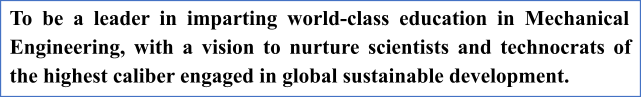


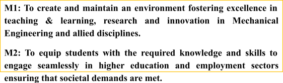

</div>

<div class="pagebreak"></div>

<div class="center">

<p style="font-size:22pt; font-weight:bold; color:#C00000;">SCHOOL OF MECHANICAL ENGINEERING</p>

<p style="font-size:22pt; font-weight:bold; color:#000099;">B.Tech.</p>

<p style="font-size:22pt; font-weight:bold; color:#000099;">Mechanical Engineering</p>

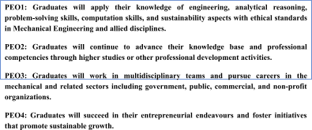


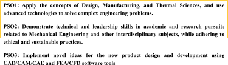

</div>

<div class="pagebreak"></div>

<div class="center">

<p style="font-size:22pt; font-weight:bold; color:#C00000;">SCHOOL OF MECHANICAL ENGINEERING</p>

<p style="font-size:22pt; font-weight:bold; color:#000099;">B.Tech</p>

<p style="font-size:22pt; font-weight:bold; color:#000099;">Mechanical Engineering</p>

<p style="font-size:22pt; font-weight:bold; color:#000099;">(Electric Vehicle)</p>


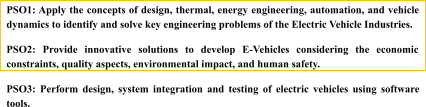

</div>

<div class="pagebreak"></div>

<div class="center">

<p style="font-size:22pt; font-weight:bold; color:#C00000;">SCHOOL OF MECHANICAL ENGINEERING</p>

<p style="font-size:22pt; font-weight:bold; color:#000099;">B.Tech</p>

<p style="font-size:22pt; font-weight:bold; color:#000099;">Mechatronics and Automation</p>


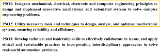

</div>

<div class="pagebreak"></div>

<div class="center">

<p style="font-size:18pt; font-weight:bold;">BMHA314E AUTONOMOUS MOBILE ROBOTS</p>

</div>

| **Sl. No.** | **Course Outcome(s)** | **COs** |
| :-: | :-: | :-: |
| 1 | Understand the fundamentals and various types of autonomous mobile robots. | CO1 |
| 2 | Formulate Kinematics and dynamic model of mobile robots. | CO2 |
| 3 | Select appropriate sensors and perception algorithms for autonomy | CO3 |
| 4 | Develop localization and mapping algorithms that enable autonomous mobile robots to accurately determine their position and build maps of their surroundings. | CO4 |
| 5. | Design and execute autonomous navigation tasks, including path planning, obstacle avoidance, and dynamic environment interaction. | CO5 |
| 6. | Understand the fundamentals of multi-robot systems. | CO6 |

<div class="center">

<p style="font-size:16pt; font-weight:bold;">MARK CONFIGURATION</p>

</div>

| **Evaluation Rubrics** | |
| :-: | :-: |
| **Objective (s)/ Tools Required/ Procedure** | **01** |
| **Conducting Experiments / Data Collection / Calculation** | **05** |
| **Results** | **01** |
| **Inference / Understanding / Quiz** | **03** |
| **Total** | **10** |

<div class="pagebreak"></div>

<div class="center">

<p style="font-size:16pt; font-weight:bold;">SYLLABUS</p>

</div>

| **Course Code** | **Course Title** | **L** | **T** | **P** | **C** |
| :-: | :-: | :-: | :-: | :-: | :-: |
| **BMHA314E** | **Autonomous Mobile Robots** | **3** | **0** | **2** | **4** |
| **Pre-requisite** | **BMHA303L, BMHA303P** | **Syllabus version** | | | |
| | | **2.0** | | | |
| **Course Objectives** | | | | | |
| 1. To understand the fundamental principles underlying autonomous mobile robots, including perception, localization, mapping, path planning, and control.<br>2. To develop practical skills in implementing algorithms for autonomous navigation and control using simulation environments and real robotic platforms.<br>3. To identify challenges and limitations in autonomous navigation and develop problem-solving skills to address complex issues in autonomous mobilerobotics. | | | | | |
| **Course Outcomes** | | | | | |
| On the successful completion of the course the students will be able to<br>1. Understand the fundamentals and various types of autonomous mobile robots.<br>2. Formulate Kinematics and dynamic model of mobile robots.<br>3. Select appropriate sensors and perception algorithms for autonomy<br>4. Develop localization and mapping algorithms that enable autonomous mobile robots to accurately determine their position and build maps of their surroundings.<br>5. Design and execute autonomous navigation tasks, including path planning, obstacle avoidance, and dynamic environment interaction.<br>6. Understand the fundamentals of multi-robot systems. | | | | | |
| **Module:1** | **Introduction** | **5 hours** | | | |
| Introduction to mobile robots and mobile manipulators - Principle of locomotion and types of locomotion - Types of mobile robots: ground robots (wheeled and legged robots), aerial robots, underwater robots, and water surface robots. | | | | | |
| **Module:2** | **Kinematics and Dynamics** | **8 hours** | | | |
| Kinematics of wheeled mobile robot - degree of freedom and maneuverability - generalized wheel model - different wheel configurations - holonomic and non-holonomic robots - Forward and inverse kinematics of mobile robots - Dynamics modeling and analysis -Trajectory planning and control. | | | | | |
| **Module:3** | **Perception for Autonomous Navigation** | **7 hours** | | | |
| Sensors for Perception - Lidar (Light Detection and Ranging), Radar (Radio Detection and Ranging), IMU (Inertial Measurement Unit), Wheel Encoders – Perception Algorithms - Visual Tracking & Servoing - Sensor fusion techniques - Object detection and recognition - Environmental understanding and scene interpretation. | | | | | |
| **Module:4** | **Localization and Mapping** | **7 hours** | | | |
| Techniques for localization: odometry, landmark-based, probabilistic methods - Maprepresentations: grid-based, feature-based, topological maps - Localization | | | | | |
| algorithms: Kalman filters, Particle filters - Map building and maintenance - Simultaneous Localization and Mapping (SLAM) | | | | | |
| **Module:5** | **Path Planning and Navigation** | **6 hours** | | | |
| Path planning algorithms: Dijkstra, A\*, RRT, potential fields - Metaheuristic and non-heuristic algorithms - Nonholonomic Motion Planning - Collision free path planning- Local and global path planning - Dynamic obstacle avoidance - Navigation control architectures - Integration with perception and localization systems. | | | | | |
| **Module:6** | **Control and Decision Making** | **6 hours** | | | |
| Control strategies for mobile robots: PID, model predictive, reinforcement learning - Behavior-based control architectures - Decision making under uncertainty - Task planning and scheduling - Safety and reliability considerations | | | | | |
| **Module:7** | **Multi robot systems and collaboration** | **4 hours** | | | |
| Multi-robot systems and coordination - Swarm robots, cooperative and collaborative robots - Human-robot interaction - Autonomous exploration - Learning-based approaches for autonomy | | | | | |
| **Module:8** | **Contemporary Issues** | **2 hours** | | | |
| | **Total Lecture hours:** | **45 hours** | | | |
| **Text Book(s)** | | | | | |
| 1. | R Siegwart, IR Nourbakhsh, D Scaramuzza, Introduction to Autonomous MobileRobots, MIT Press, USA, 2011. | | | | |
| 2. | Kelly, A, Mobile Robotics: Mathematics, Models, and Methods, Cambridge University Press, 2013. | | | | |
| **Reference Books** | | | | | |
| 1. | SG Tzafestas, Introduction to Mobile Robot Control, Elsevier, USA, 2014. | | | | |
| 2. | Hughes, C. and Hughes, T., Robot programming: a guide to controllingautonomous robots. Que Publishing, 2016 | | | | |
| Mode of Evaluation: CAT, Assignment, Projects, Quiz, FAT | | | | | |
| **List of Experiments (Indicative)** | | | | | |
| 1. | Setting up the environment in ROS and understanding the fundamentals. | | | | |
| 2. | Simulate a mobile robot model (e.g., TurtleBot) in Gazebo | | | | |
| 3. | Implement SLAM (Simultaneous Localization and Mapping) using the ROSNavigation Stack | | | | |
| 4. | Design and implement a path planning algorithm using ROS navigationpackages (e.g., move\_base). | | | | |
| 5. | Implement object detection and recognition using ROS perception libraries(e.g., OpenCV, PCL). | | | | |
| 6. | Set up communication between multiple robots using ROS topics, services, oractionlib. | | | | |

<div class="pagebreak"></div>

<div class="center">

<p style="font-size:16pt; font-weight:bold;">List of Experiments</p>

</div>

| **Ex. No.** | **Date** | **Title** | **Marks** | **Signature** |
| :-: | :-: | :-: | :-: | :-: |
| **1** | | **Workspace Setup and Turtlesim Simulation Using ROS 2** | | |
| **2** | | **Controlling BeetleBot Motion Using ROS 2 Humble and Visualizing Robot State in RViz2** | | |
| **3** | | **Square Path Navigation of BeetleBot Using ROS 2** | | |
| **4** | | **Autonomous LiDAR-Based Obstacle Avoidance of BeetleBot Using ROS 2** | | |
| **5** | | **Colour Detection and Tracking with BeetleBot Using ROS 2 and OpenCV** | | |
| **6** | | **IR Sensor-Based Line Following of a 4WD Arduino Mobile Robot** | | |
| **7** | | **Line Following with Ultrasonic Obstacle Avoidance of a 4WD Arduino Mobile Robot** | | |
| **8** | | **Spawning and Autonomous Navigation of TurtleBot3 in Gazebo Using ROS 2** | | |
| **9** | | **AMR-Mounted Manipulator Pick-and-Place Simulation in Gazebo Using ROS 2** | | |
| **10** | | **Demonstration – Autonomous Multi-Waypoint Navigation of the Acrux AMR Using ROS 2 Nav2** | | |

<div class="pagebreak"></div>

## EXP: 1 Workspace Setup and Turtlesim Simulation Using ROS 2 Humble

### AIM

To create and configure a ROS 2 Humble workspace, build the workspace, permanently source the ROS environment, and verify the installation by controlling the Turtlesim robot using keyboard teleoperation.

### PRINCIPLE

Robot Operating System 2 (ROS 2) is an open-source software framework used for developing robotic applications. It provides tools and libraries that enable communication between different parts of a robot, such as sensors, controllers, and actuators. Before developing any ROS-based application, a workspace must be created where packages and projects are stored.

A ROS workspace acts as the development environment for writing, compiling, and executing robotic programs. After the workspace is created, it is built using the colcon build system. To avoid manually configuring the environment every time a new terminal is opened, the workspace is added to the bashrc file, allowing it to be sourced automatically.

Turtlesim is a lightweight simulator included with ROS 2 that provides a simple graphical turtle. It is commonly used to verify that ROS has been installed correctly and to understand the basic concepts of ROS nodes, topics, and message passing. The turtle can be controlled using keyboard teleoperation, making it an ideal introductory simulation before working with physical robots.

### MATERIALS REQUIRED

- Laptop/Desktop running Ubuntu 22.04 LTS
- Keyboard
- Internet connection

### SOFTWARE USED

- Ubuntu 22.04 LTS
- ROS 2 Humble
- Turtlesim
- Terminal
- Colcon Build System

### PROCEDURE

**Step 1: Source the ROS 2 Humble Environment**

**Command**

```bash
source /opt/ros/humble/setup.bash
```

**Explanation**

This command loads the ROS 2 Humble environment into the current terminal session. It configures the necessary environment variables required to use ROS 2 commands. This command must be executed before working with any ROS 2 packages.

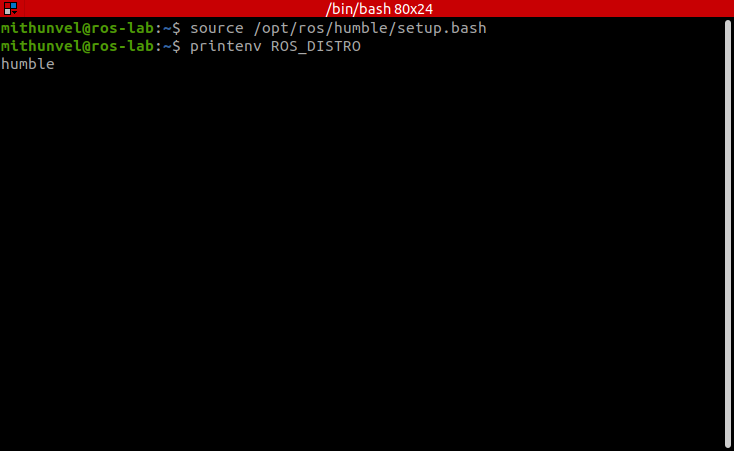

<p style="text-align:center"><em>Sourcing the ROS 2 Humble environment (ROS_DISTRO = humble). Captured on the lab laptop, ROS 2 Humble.</em></p>

**Step 2: Create the Workspace**

**Command**

```bash
mkdir -p ~/23BMH1029/src
```

**Explanation**

This command creates a new ROS 2 workspace named 23BMH1029, where 23BMH1029 is the registration number. The -p option automatically creates all required parent directories, while the src folder stores the source code of ROS packages.

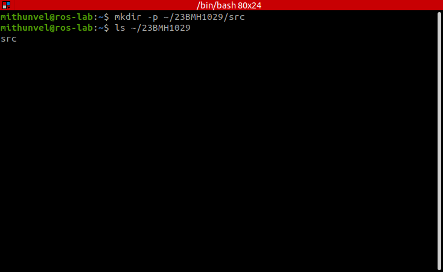

<p style="text-align:center"><em>Creating the workspace 23BMH1029/src. Captured on the lab laptop, ROS 2 Humble.</em></p>

**Step 3: Navigate to the Workspace**

**Command**

```bash
cd ~/23BMH1029
```

**Explanation**

This command changes the current working directory to the newly created ROS workspace. All subsequent build commands will be executed from this directory.

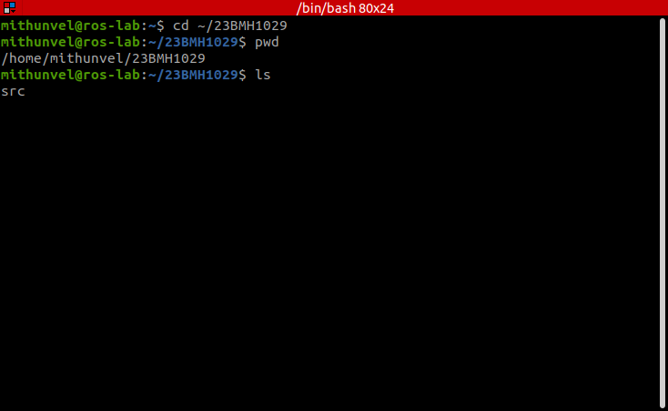

<p style="text-align:center"><em>Changing into the workspace. Captured on the lab laptop, ROS 2 Humble.</em></p>

**Step 4: Build the Workspace**

**Command**

```bash
colcon build
```

**Explanation**

The colcon build command compiles all packages available in the workspace. Even though the workspace is currently empty, building it generates the necessary folders (build, install, and log) required for future ROS development.

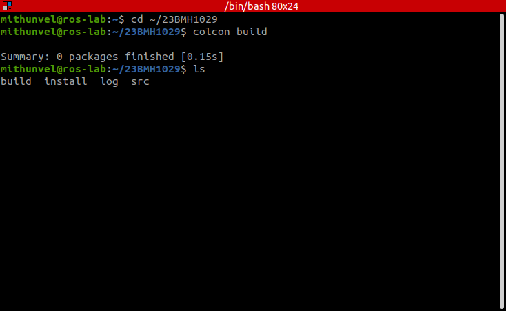

<p style="text-align:center"><em>colcon build on the empty workspace. Captured on the lab laptop, ROS 2 Humble.</em></p>

**Step 5: Source the Workspace**

**Command**

```bash
source 23BMH1029/install/setup.bash
```

**Explanation**

This command in a new terminal window loads the environment of the workspace that was just built. It enables ROS 2 to recognize packages that will be created inside this workspace.

**Step 6: Configure the Workspace to Load Automatically**

**Command**

```bash
gedit ~/.bashrc
```

**Explanation**

This command opens the .bashrc file in the Gedit text editor. The .bashrc file is a shell configuration file that is executed automatically every time a new terminal is opened. By adding the workspace sourcing command to this file, the ROS 2 workspace will be loaded automatically, eliminating the need to source it manually each time. Scroll to the end of the .bashrc file and add the following line:

```bash
source ~/23BMH1029/install/setup.bash
```

Save the file and close the editor.

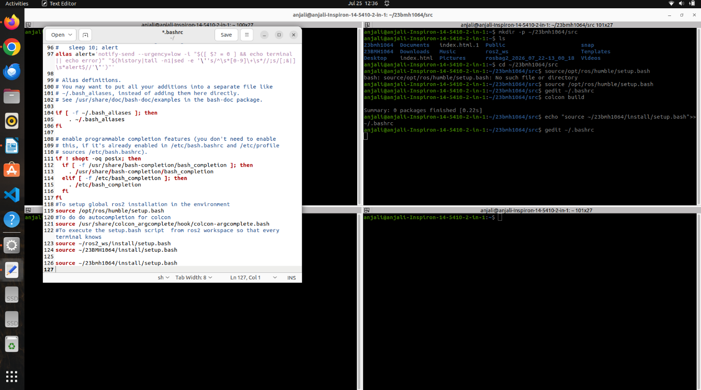

**Step 7: Reload the Bash Configuration**

**Command**

```bash
source ~/.bashrc
```

**Explanation**

This command reloads the updated ..bashrc file without requiring the terminal to be restarted. It immediately applies the changes made in the previous step.

**Step 8: Install Turtlesim**

**Command**

```bash
sudo apt update
```

**Explanation**

This command updates the Ubuntu package list to ensure that the latest package information is available before installing new software.

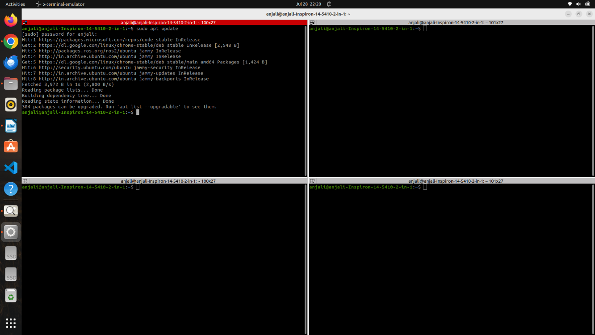

**Step 9: Install the Turtlesim Package**

**Command**

```bash
sudo apt install ros-humble-turtlesim
```

**Explanation**

This command installs the Turtlesim simulator included with ROS 2 Humble. It provides a simple graphical turtle that can be used to learn basic ROS concepts and verify that the ROS installation is functioning correctly.

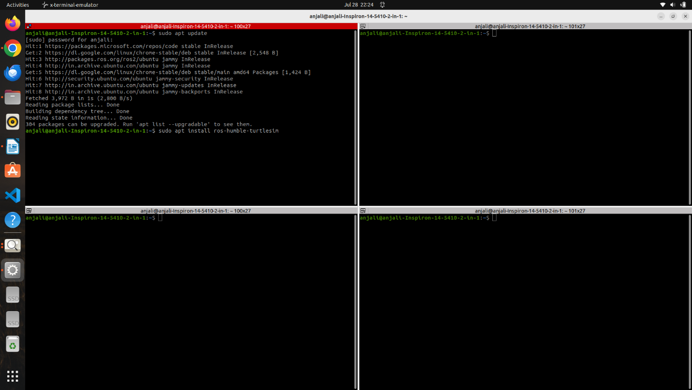

**Step 10: Launch Turtlesim**

**Command**

```bash
ros2 run turtlesim turtlesim_node
```

**Explanation**

This command starts the Turtlesim node and opens a graphical simulation window containing the turtle. The turtle waits for movement commands from another ROS node.

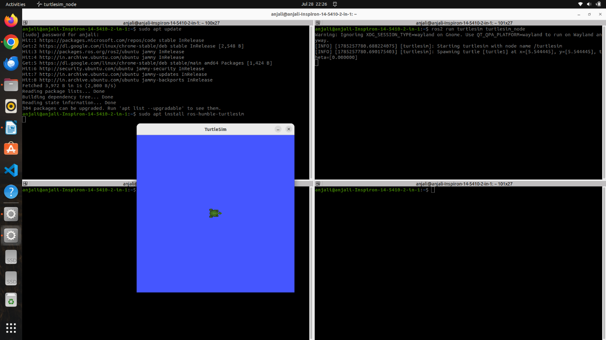

**Step 11: Control the Turtle** (Open a new terminal, source the ROS environment if necessary, and run:)

```bash
ros2 run turtlesim turtle_teleop_key
```

**Explanation**

This command starts the keyboard teleoperation node. The node publishes velocity commands based on the arrow keys pressed, allowing the turtle to move forward, backward, left, and right within the simulation window.

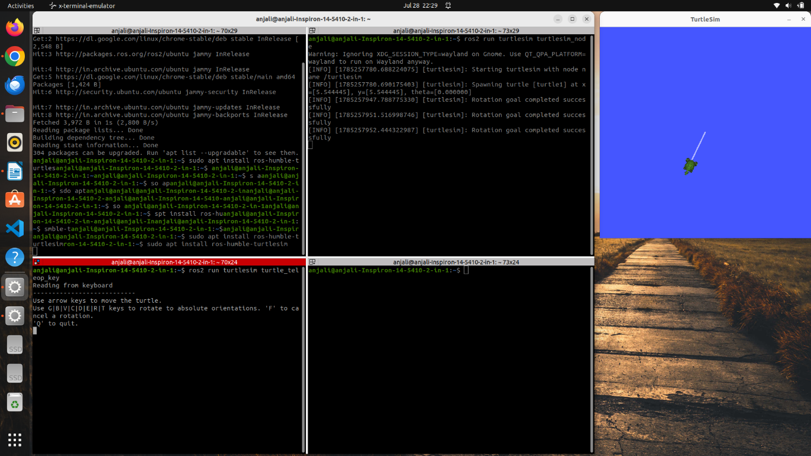

### RESULT

A ROS 2 Humble workspace named 23BMH1029 was successfully created and configured. The workspace was built using the Colcon build system and permanently added to the .bashrc configuration file. The Turtlesim package was installed successfully, and the turtle was controlled using keyboard teleoperation, confirming that the ROS 2 installation and workspace configuration were functioning correctly.

| **Evaluation Rubrics** | | |
| :-: | :-: | :-: |
| **Objective (s)/ Tools Required/ Procedure** | **01** | |
| **Conducting Experiments / Data Collection / Calculation** | **05** | |
| **Results** | **01** | |
| **Inference / Understanding / Quiz** | **03** | |
| **Total** | **10** | |
| **Faculty Signature with Date** | | |

<div class="pagebreak"></div>

## EXP 2: Controlling BeetleBot Motion Using ROS 2 Humble and Visualizing Robot State in RViz2

### AIM

To establish communication with the BeetleBot through SSH, initialize the robot using the Lyra bringup package, visualize the robot model and sensor data in RViz2, monitor active ROS topics and camera feed, and control the robot using ROS 2 velocity commands.

### PRINCIPLE

ROS 2 allows a computer to communicate with a robot over a network using distributed nodes. After connecting to the BeetleBot through SSH, the robot's software packages are loaded and the hardware bringup file initializes essential components such as the LiDAR, wheel motors, IMU, and communication interfaces.

The robot receives movement commands through the /cmd_vel_nav topic. These commands are published using the geometry_msgs/Twist message, where the linear velocity controls forward or backward movement and the angular velocity controls turning.

RViz2 is the visualization software provided with ROS 2. It displays the robot model, coordinate frames, odometry, occupancy map, and sensor data in real time. This enables users to verify that the robot is operating correctly while executing motion commands.

### MATERIALS REQUIRED

- BeetleBot Mobile Robot
- Laptop/Desktop with Ubuntu 22.04 LTS
- Wi-Fi connection to BeetleBot
- Keyboard and Mouse

### SOFTWARE USED

- Ubuntu 22.04 LTS
- ROS 2 Humble
- RViz2

### PROCEDURE

**Step 1: Connect to the BeetleBot using SSH**

**Command**

```bash
ssh veerobot@192.168.0.122
```

**Explanation**

This command establishes a secure remote terminal session with the BeetleBot over the local network. Once connected, all subsequent ROS commands will be executed directly on the robot.

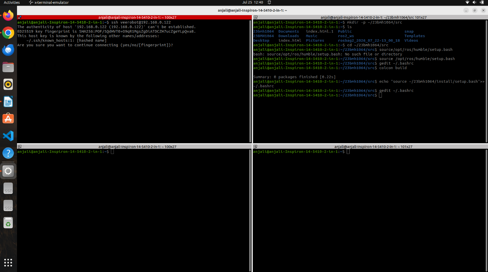

**Step 2: Navigate to the Lyra Workspace**

**Command**

```bash
cd ~/lyra_ws
```

**Explanation**

This command changes the current directory to the Lyra ROS workspace, which contains all the packages required for operating the BeetleBot.

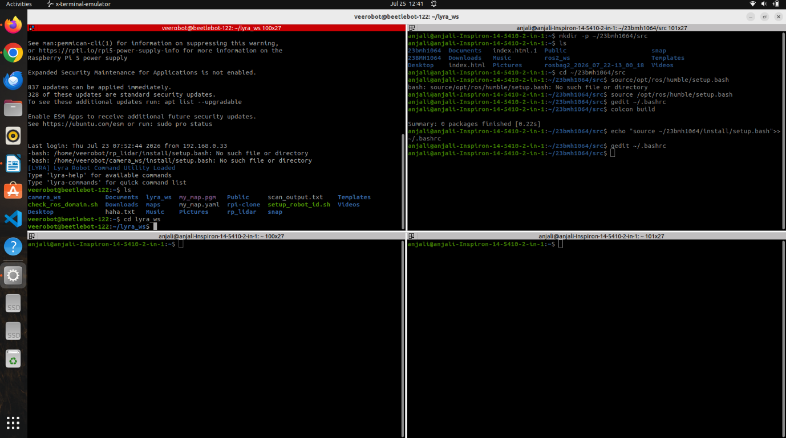

**Step 3: Source the ROS 2 Humble Environment**

**Command**

```bash
source /opt/ros/humble/setup.bash
```

**Explanation**

This command loads the ROS 2 Humble environment and makes all ROS commands available in the current terminal session.

**Step 4: Source the Lyra Workspace**

**Command**

```bash
source ~/lyra_ws/install/setup.bash
```

**Explanation**

This command loads the compiled Lyra workspace so that all BeetleBot-specific ROS packages become available.

**Step 5: Set the ROS Domain ID**

**Command**

```bash
export ROS_DOMAIN_ID=122
```

**Explanation**

The ROS Domain ID allows the laptop and the BeetleBot to communicate within the same ROS network. Both devices must use the same Domain ID for successful communication.

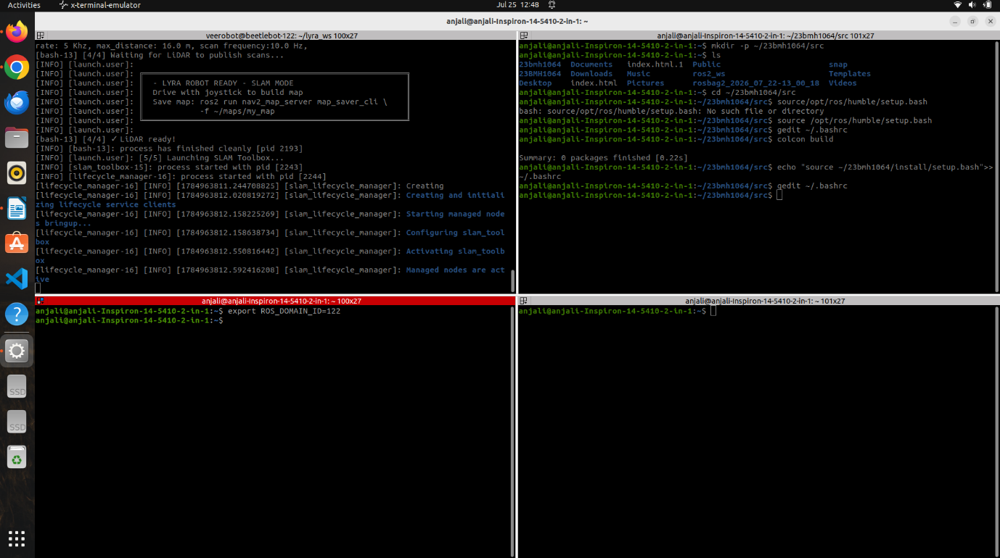

**Step 6: Launch the BeetleBot Bringup Package**

**Command**

```bash
ros2 launch lyra_bringup robot.launch.py
```

**Explanation**

This command starts the primary BeetleBot bringup file. It initializes the LiDAR, IMU, motor controllers, TF tree, odometry, and all other hardware interfaces required for robot operation.

**Note:** **Do not close this terminal.** Keep it running throughout the experiment because it continuously publishes sensor data and controls the hardware.

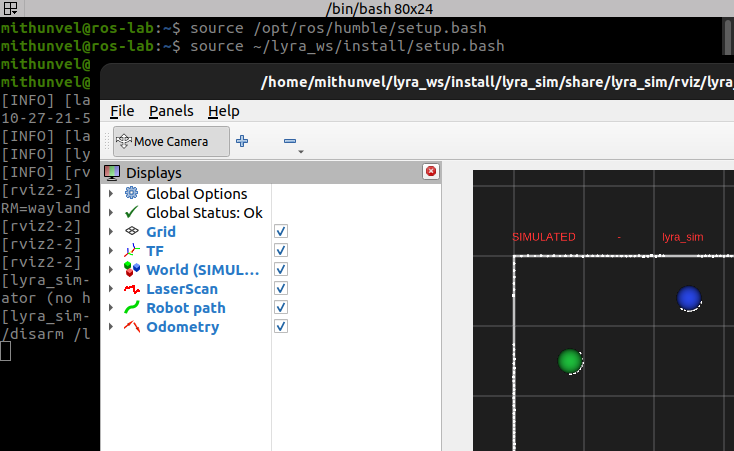

<p style="text-align:center"><em>Starting the BeetleBot emulator (lyra_sim, ROS_DOMAIN_ID=122). Simulated: captured from the lyra_sim emulator (no robot hardware).</em></p>

**Image**

**Step 7: Open RViz2 (New Terminal)**

Open a **new terminal** on the laptop.

**Commands**

```bash
source /opt/ros/humble/setup.bash
source ~/lyra_ws/install/setup.bash
export ROS_DOMAIN_ID=122
rviz2
```

**Explanation**

These commands prepare the new terminal by loading the ROS environment and Lyra workspace. The rviz2 command launches the ROS visualization tool, which displays the robot model and live sensor information.

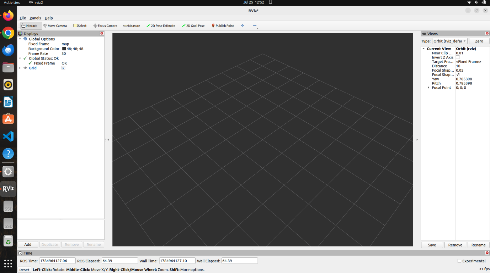

**Step 8: Configure RViz2**

After RViz2 opens:

1. Click Add in the Displays panel.
2. Select RobotModel and click OK.
3. Click Add again and select TF.
4. Click Add again and select Odometry.
5. Click Add again and select Map.
6. Set the Fixed Frame to map.
7. Verify that the robot model, coordinate frames, odometry information, and occupancy map are displayed correctly.

**Explanation**

Adding these displays allows visualization of the robot's position, orientation, coordinate frames, and generated map in real time. This helps verify that localization and sensor data are functioning correctly.

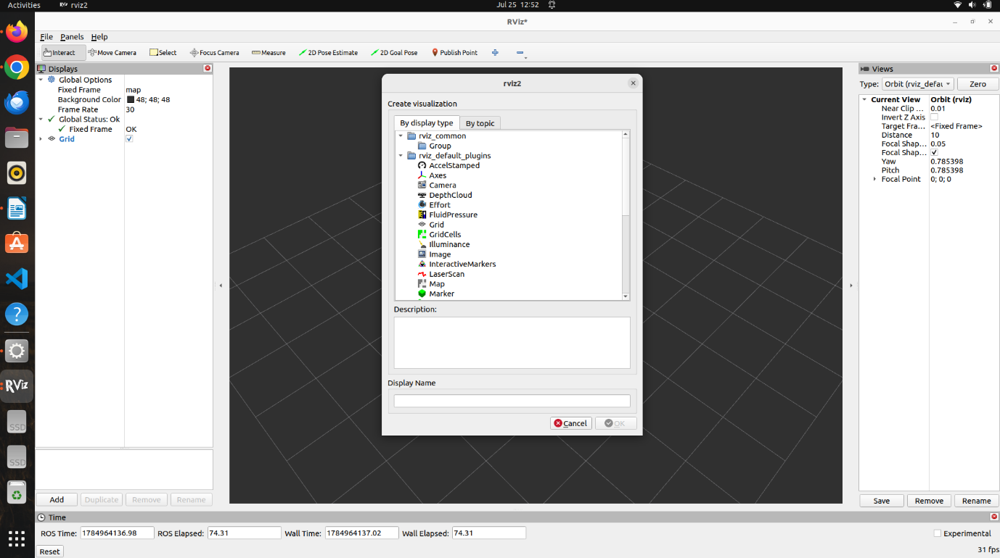

*Adding the Robot Model*

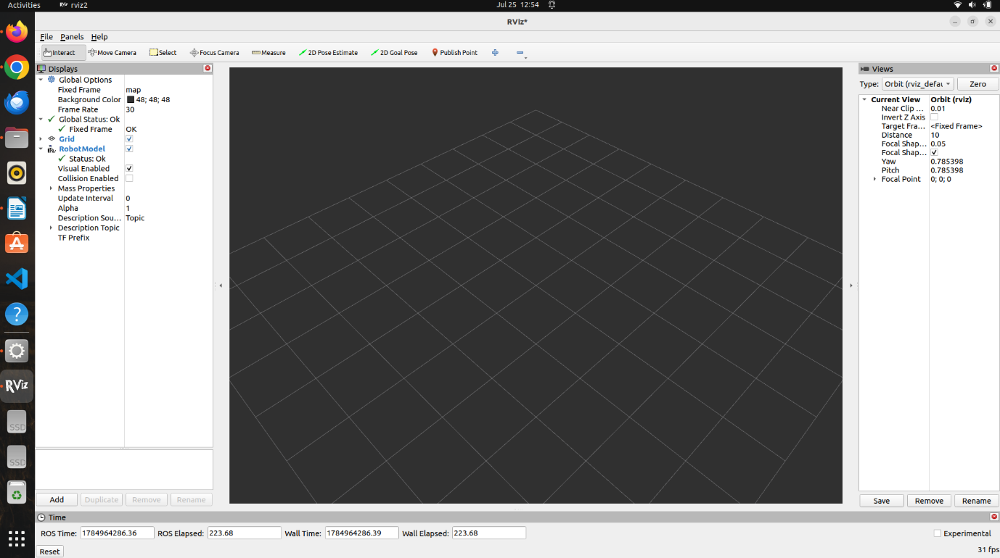

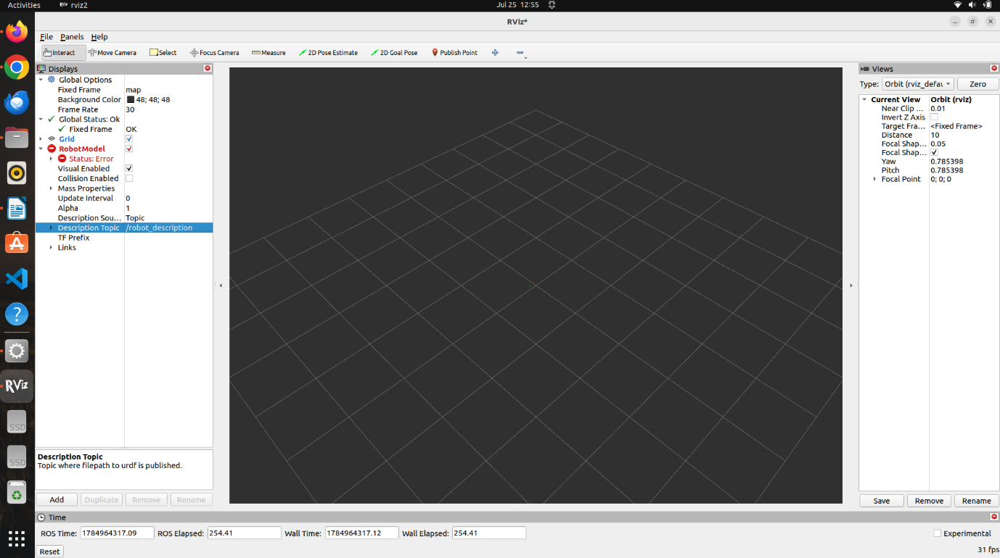

*Selecting robot description under Description Topic*


*Adding the TF*

*Adding the Odometery*

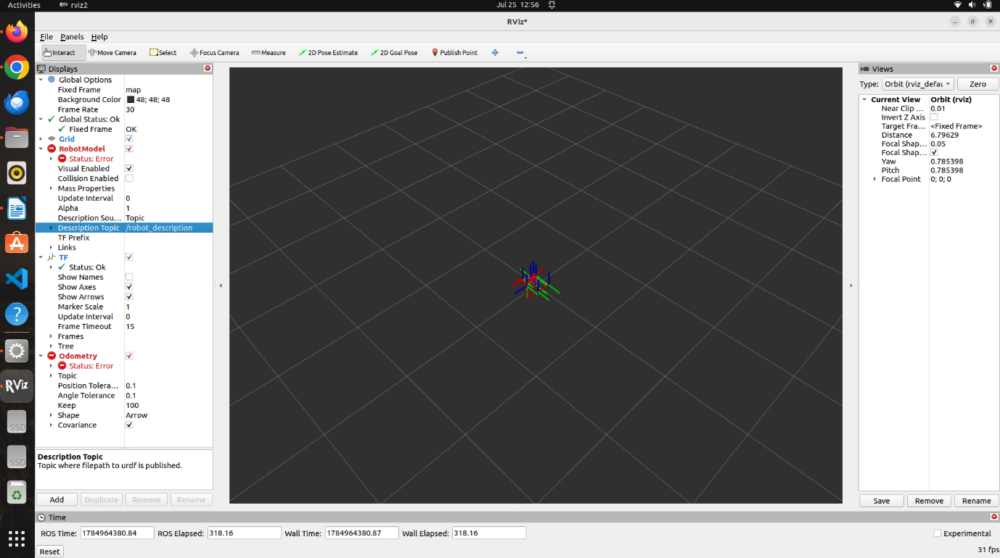

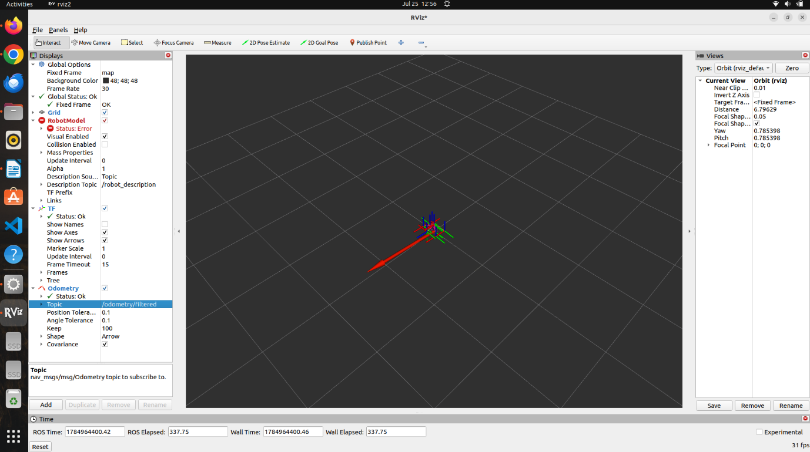

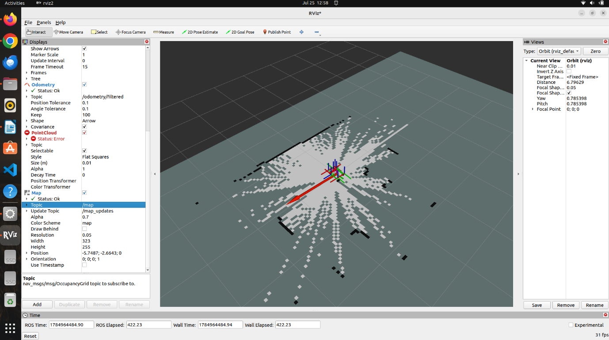

*Adding the Map*

**Step 9: Arm the Robot (New Terminal)**

Open another terminal and reconnect to the BeetleBot.

**Commands**

```bash
ssh veerobot@192.168.0.122
source /opt/ros/humble/setup.bash
source home/lyra_ws/install/setup.bash
export ROS_DOMAIN_ID=122
ros2 service call /lyra/arm std_srvs/srv/Trigger
```

**Explanation**

The BeetleBot starts in a protected state where the wheel motors are disabled. Calling the /lyra/arm service enables the motor controllers so that velocity commands can be accepted.

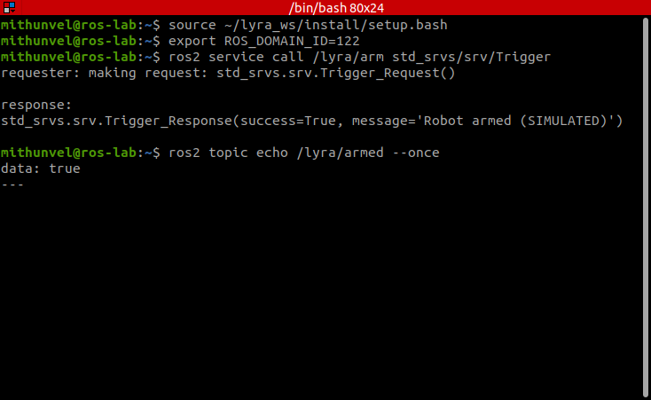

<p style="text-align:center"><em>Arming the robot: /lyra/arm succeeds and /lyra/armed reads true. Simulated: captured from the lyra_sim emulator (no robot hardware).</em></p>

**Step 10: Move the Robot Forward**

**Command**

```bash
ros2 topic pub -r 10 -t 50 /cmd_vel_nav geometry_msgs/msg/Twist "{linear: {x: 0.3, y: 0.0, z: 0.0}, angular: {x: 0.0, y: 0.0, z: 0.0}}" && ros2 topic pub -r 10 -t 15 /cmd_vel_nav geometry_msgs/msg/Twist "{linear: {x: 0.0, y: 0.0, z: 0.0}, angular: {x: 0.0, y: 0.0, z: 0.0}}"
```

**Explanation**

This command publishes a forward velocity of **0.3 m/s** for approximately **5 seconds**. After the movement is completed, a zero-velocity command is automatically published to stop the robot safely.

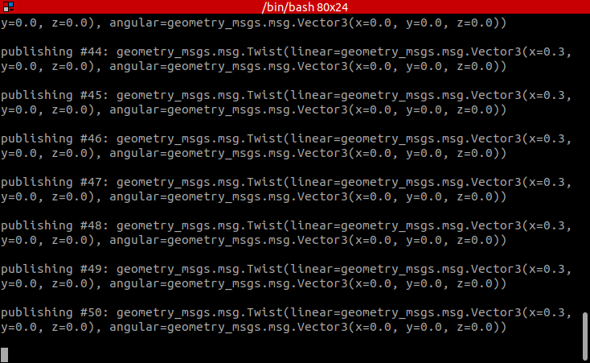

<p style="text-align:center"><em>Publishing 0.3 m/s forward on /cmd_vel_nav. Simulated: captured from the lyra_sim emulator (no robot hardware).</em></p>

**Step 11: Move the Robot Backward**

**Command**

```bash
ros2 topic pub -r 10 -t 50 /cmd_vel_nav geometry_msgs/msg/Twist "{linear: {x: -0.3, y: 0.0, z: 0.0}, angular: {x: 0.0, y: 0.0, z: 0.0}}" && ros2 topic pub -r 10 -t 15 /cmd_vel_nav geometry_msgs/msg/Twist "{linear: {x: 0.0, y: 0.0, z: 0.0}, angular: {x: 0.0, y: 0.0, z: 0.0}}"
```

**Explanation**

This command commands the BeetleBot to move backward at 0.3 m/s for approximately 5 seconds. A stop command is automatically issued afterward to halt the robot.

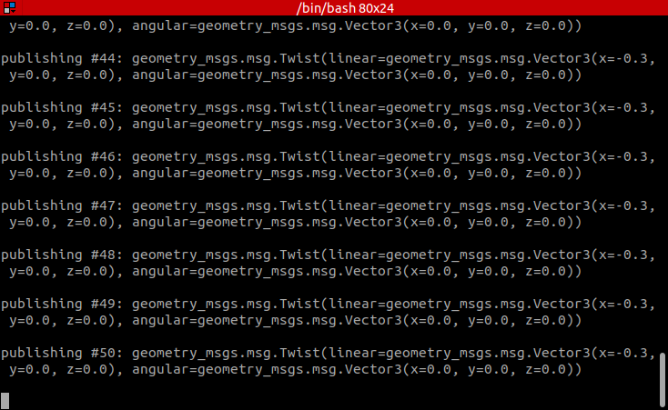

<p style="text-align:center"><em>Publishing -0.3 m/s (reverse) on /cmd_vel_nav. Simulated: captured from the lyra_sim emulator (no robot hardware).</em></p>

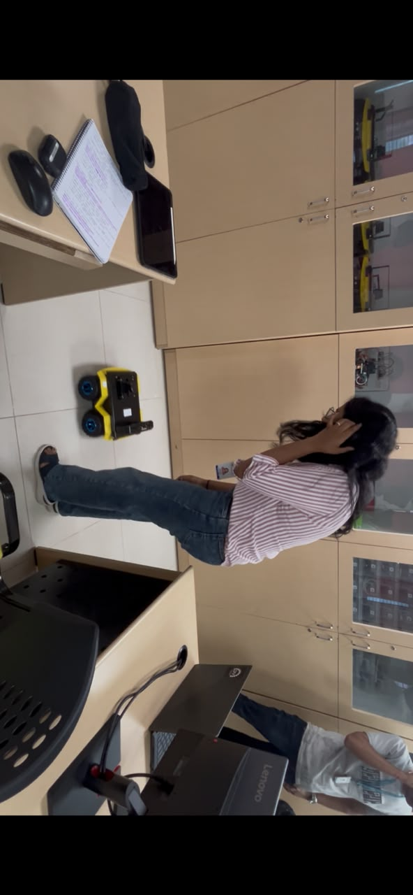

**Step 12: Stop the Robot (Emergency Stop)**

**Command**

```bash
ros2 topic pub -r 20 -t 40 /cmd_vel_nav geometry_msgs/msg/Twist "{linear: {x: 0.0, y: 0.0, z: 0.0}, angular: {x: 0.0, y: 0.0, z: 0.0}}"
```

**Explanation**

This command repeatedly publishes a zero-velocity message to ensure that the BeetleBot comes to a complete stop. It serves as a software emergency stop and is used whenever the robot must be halted immediately.

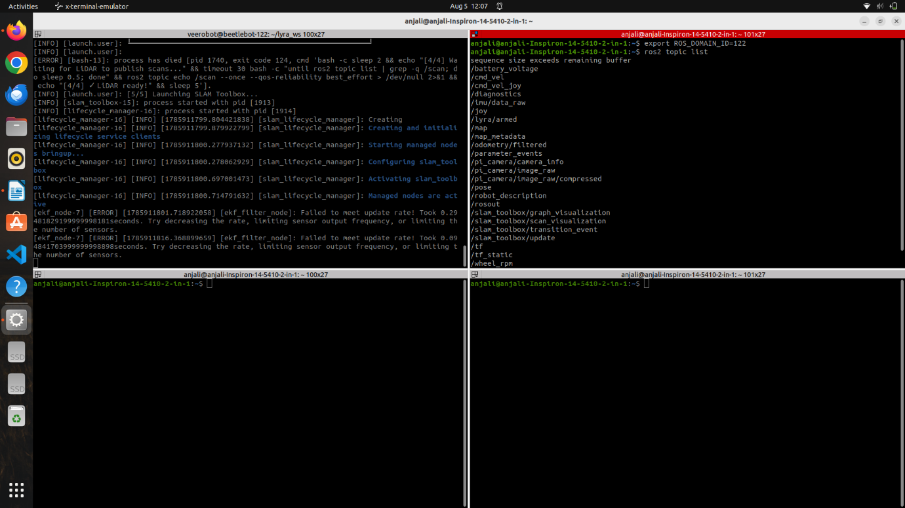

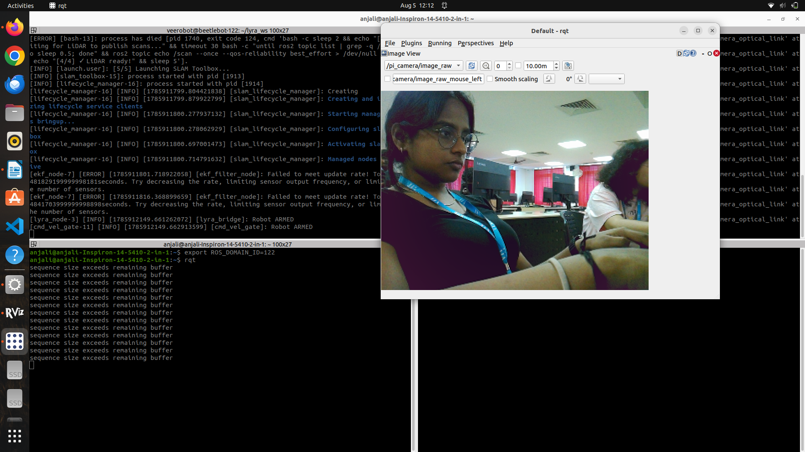

**Step 11: Display the Active ROS Topics**

**Command**

```bash
ros2 topic list
```

**Explanation**

This command lists all the active ROS 2 topics currently being published and subscribed to by the BeetleBot. It is used to verify that the robot's sensors, camera, odometry, transform frames, and motion control topics are active and communicating correctly.

**Step 12: Display the Camera**

**Command**

```bash
rqt
```

**Explanation**

The rqt command launches the RQT graphical interface, a plugin-based visualization and debugging tool provided with ROS 2. It offers a collection of utilities for monitoring and interacting with ROS nodes, topics, services, and parameters through a user-friendly interface. In this experiment, RQT is used to view the live camera feed published by the BeetleBot by selecting the appropriate Image View plugin and subscribing to the camera topic. This allows users to verify that the onboard camera is functioning correctly and streaming images in real time.

.

### RESULT

A secure SSH connection was successfully established with the BeetleBot, and the Lyra workspace was initialized using ROS 2 Humble. The robot hardware was activated through the bringup package, and RViz2 was configured to display the Robot Model, TF frames, Odometry, Map, and live camera feed. The robot was successfully controlled using ROS 2 velocity commands, and the active ROS topics were verified, demonstrating successful communication, visualization, sensor monitoring, and robot motion using ROS 2.

| **Evaluation Rubrics** | | |
| :-: | :-: | :-: |
| **Objective (s)/ Tools Required/ Procedure** | **01** | |
| **Conducting Experiments / Data Collection / Calculation** | **05** | |
| **Results** | **01** | |
| **Inference / Understanding / Quiz** | **03** | |
| **Total** | **10** | |
| **Faculty Signature with Date** | | |

<div class="pagebreak"></div>

## EXP 3: Square Path Navigation of BeetleBot Using ROS 2 Humble

### AIM

To establish communication with the BeetleBot using SSH, initialize the robot hardware through the Lyra workspace, visualize the robot in RViz2, and control the robot to traverse a square path using ROS 2 velocity commands.

### PRINCIPLE

ROS 2 enables communication between a computer and a mobile robot through a distributed network of nodes. After establishing a secure SSH connection with the BeetleBot, the robot hardware is initialized by launching the Lyra bringup package, which activates essential components such as the LiDAR sensor, motor controllers, odometry, and transform (TF) frames.

The BeetleBot receives motion commands through the **/cmd_vel_nav** topic using the **geometry_msgs/msg/Twist** message type. The linear velocity component controls forward and backward motion, while the angular velocity component controls the robot's rotation. By combining these velocity commands in a specific sequence, the robot can be made to follow different trajectories.

RViz2 is used to visualize the robot model, coordinate frames, odometry information, and occupancy map in real time. This allows the user to monitor the robot's movement while verifying that localization and sensor data are functioning correctly. In this experiment, a sequence of forward and rotational velocity commands is executed to move the BeetleBot along a square path.

### MATERIALS REQUIRED

- BeetleBot (Lyra) Mobile Robot
- Laptop/Desktop with Ubuntu 22.04 LTS
- Wi-Fi connection to the BeetleBot
- Keyboard and Mouse

### SOFTWARE USED

- Ubuntu 22.04 LTS
- ROS 2 Humble
- RViz2
- SSH
- Terminal

### PROCEDURE

**Step 1: Verify Network Connectivity**

**Command**

```bash
ping 192.168.0.128
```

**Explanation**

This command checks whether the laptop and the BeetleBot are connected to the same local network. Continuous replies indicate successful communication between the two devices.

**Step 2: Connect to the BeetleBot Using SSH**

**Command**

```bash
ssh veerobot@192.168.0.128
```

**Explanation**

This command establishes a secure remote terminal session with the BeetleBot. After entering the password, commands executed in this terminal will run directly on the robot.

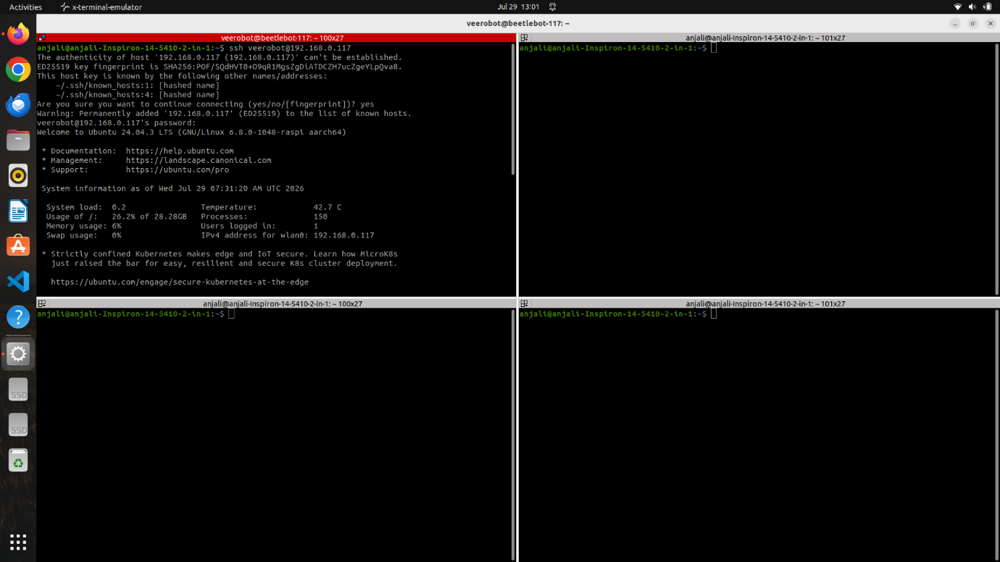

**Step 3: Navigate to the Lyra Workspace**

**Command**

```bash
cd ~/lyra_ws
```

**Explanation**

This command changes the current directory to the Lyra ROS workspace, which contains all packages required for operating the BeetleBot.


**Step 4: Set the ROS Domain ID**

**Command**

```bash
export ROS_DOMAIN_ID=122
```

**Explanation**

The ROS Domain ID ensures that the laptop communicates only with the intended BeetleBot. Both the robot and the host computer must use the same Domain ID for successful communication.

**Step 5: Launch the Robot Bringup Package**

**Command**

```bash
ros2 launch lyra_bringup robot.launch.py
```

**Explanation**

This command initializes all the major hardware interfaces of the BeetleBot, including the LiDAR sensor, motor controllers, odometry, TF tree, and communication nodes.

**Note:** Keep this terminal open throughout the experiment because it continuously manages the robot hardware.

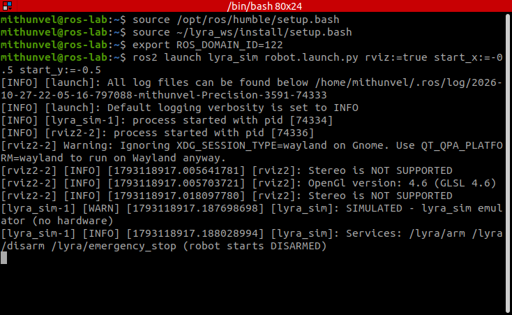

<p style="text-align:center"><em>Emulator started at (-0.5, -0.5), ROS_DOMAIN_ID=122. Simulated: captured from the lyra_sim emulator (no robot hardware).</em></p>

**Step 6: Arm the Robot**

Open another terminal and execute:

```bash
ssh veerobot@192.168.0.128
source ~/lyra_ws/install/setup.bash
export ROS_DOMAIN_ID=122
ros2 service call /lyra/arm std_srvs/srv/Trigger
```

**Explanation**

For safety, the BeetleBot starts in a disarmed state. This service call enables the motor controllers, allowing the robot to accept movement commands.

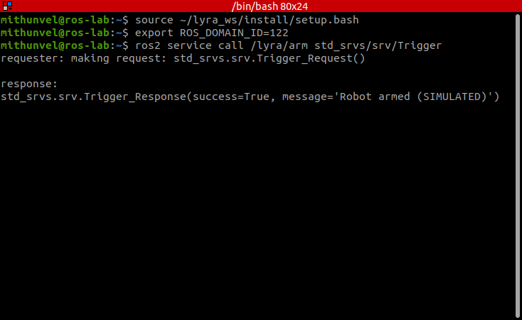

<p style="text-align:center"><em>Arming the robot. Simulated: captured from the lyra_sim emulator (no robot hardware).</em></p>

**Step 7: Execute the Square Path Motion**

**Command**

```bash
ros2 topic pub -r 10 -t 30 /cmd_vel_nav geometry_msgs/msg/Twist \
"{linear: {x: 0.3, y: 0.0, z: 0.0}, angular: {x: 0.0, y: 0.0, z: 0.0}}" && \
ros2 topic pub -r 10 -t 10 /cmd_vel_nav geometry_msgs/msg/Twist \
"{linear: {x: 0.0, y: 0.0, z: 0.0}, angular: {x: 0.0, y: 0.0, z: 0.0}}" && \
ros2 topic pub -r 10 -t 20 /cmd_vel_nav geometry_msgs/msg/Twist \
"{linear: {x: 0.0, y: 0.0, z: 0.0}, angular: {x: 0.0, y: 0.0, z: 1.0}}" && \
ros2 topic pub -r 10 -t 10 /cmd_vel_nav geometry_msgs/msg/Twist \
"{linear: {x: 0.0, y: 0.0, z: 0.0}, angular: {x: 0.0, y: 0.0, z: 0.0}}" && \
ros2 topic pub -r 10 -t 30 /cmd_vel_nav geometry_msgs/msg/Twist \
"{linear: {x: 0.3, y: 0.0, z: 0.0}, angular: {x: 0.0, y: 0.0, z: 0.0}}" && \
ros2 topic pub -r 10 -t 10 /cmd_vel_nav geometry_msgs/msg/Twist \
"{linear: {x: 0.0, y: 0.0, z: 0.0}, angular: {x: 0.0, y: 0.0, z: 0.0}}" && \
ros2 topic pub -r 10 -t 20 /cmd_vel_nav geometry_msgs/msg/Twist \
"{linear: {x: 0.0, y: 0.0, z: 0.0}, angular: {x: 0.0, y: 0.0, z: 1.0}}" && \
ros2 topic pub -r 10 -t 10 /cmd_vel_nav geometry_msgs/msg/Twist \
"{linear: {x: 0.0, y: 0.0, z: 0.0}, angular: {x: 0.0, y: 0.0, z: 0.0}}" && \
ros2 topic pub -r 10 -t 30 /cmd_vel_nav geometry_msgs/msg/Twist \
"{linear: {x: 0.3, y: 0.0, z: 0.0}, angular: {x: 0.0, y: 0.0, z: 0.0}}" && \
ros2 topic pub -r 10 -t 10 /cmd_vel_nav geometry_msgs/msg/Twist \
"{linear: {x: 0.0, y: 0.0, z: 0.0}, angular: {x: 0.0, y: 0.0, z: 0.0}}" && \
ros2 topic pub -r 10 -t 20 /cmd_vel_nav geometry_msgs/msg/Twist \
"{linear: {x: 0.0, y: 0.0, z: 0.0}, angular: {x: 0.0, y: 0.0, z: 1.0}}" && \
ros2 topic pub -r 10 -t 10 /cmd_vel_nav geometry_msgs/msg/Twist \
"{linear: {x: 0.0, y: 0.0, z: 0.0}, angular: {x: 0.0, y: 0.0, z: 0.0}}" && \
ros2 topic pub -r 10 -t 30 /cmd_vel_nav geometry_msgs/msg/Twist \
"{linear: {x: 0.3, y: 0.0, z: 0.0}, angular: {x: 0.0, y: 0.0, z: 0.0}}" && \
ros2 topic pub -r 10 -t 15 /cmd_vel_nav geometry_msgs/msg/Twist \
"{linear: {x: 0.0, y: 0.0, z: 0.0}, angular: {x: 0.0, y: 0.0, z: 0.0}}"
```

**Explanation**

This command publishes a sequence of Twist messages to the /cmd_vel_nav topic to control the BeetleBot's movement. The robot moves forward at 0.3 m/s, stops briefly, rotates 90° using an angular velocity of 1.0 rad/s, and stops again. This Forward → Stop → Turn → Stop sequence is repeated four times, enabling the robot to traverse a square path before coming to a complete stop.

The geometry_msgs/msg/Twist message defines the robot's motion, where linear.x controls forward movement and angular.z controls rotation. The option -r 10 publishes commands at 10 Hz for smooth motion, -t specifies the number of messages to publish (thereby controlling the duration of each movement), and && ensures that each command executes only after the previous one has finished.


<p style="text-align:center"><em>Square-path command exactly as recorded (turn: 1.0 rad/s for 20 messages). In the emulator this turns about 140 degrees per corner, so the path is a star, not a square. Simulated: captured from the lyra_sim emulator (no robot hardware).</em></p>

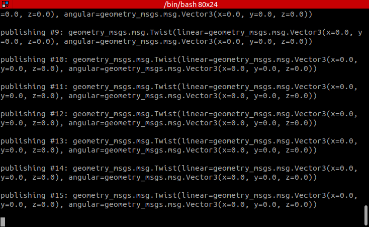

<p style="text-align:center"><em>Same sequence with the turn shortened to 12 messages (about 90 degrees per corner), which draws a near-square. Simulated: captured from the lyra_sim emulator (no robot hardware).</em></p>

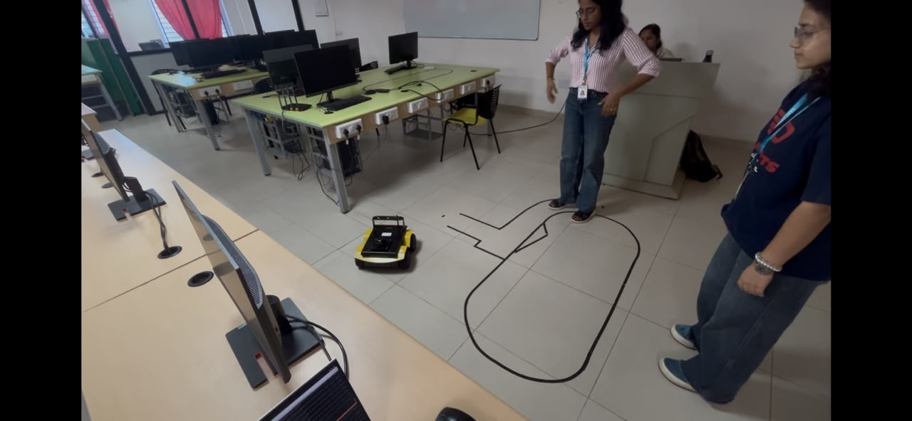

### RESULT

A secure SSH connection was successfully established with the BeetleBot, and the Lyra workspace was initialized using ROS 2 Humble. The robot hardware was activated through the bringup package, and RViz2 was configured to display the Robot Model, TF frames, Odometry, and Map. After arming the robot, velocity commands were published to the /cmd_vel_nav topic, enabling the BeetleBot to move along a square path. The experiment demonstrated successful communication, visualization, and motion control of the robot using ROS 2.

| **Evaluation Rubrics** | | |
| :-: | :-: | :-: |
| **Objective (s)/ Tools Required/ Procedure** | **01** | |
| **Conducting Experiments / Data Collection / Calculation** | **05** | |
| **Results** | **01** | |
| **Inference / Understanding / Quiz** | **03** | |
| **Total** | **10** | |
| **Faculty Signature with Date** | | |

<div class="pagebreak"></div>

## EXP 4: Autonomous LiDAR-Based Obstacle Avoidance of BeetleBot Using ROS 2

### AIM

To write a custom ROS 2 Python node that subscribes to the BeetleBot's LiDAR scan (/scan), detects obstacles within a safe distance directly ahead, and autonomously publishes velocity commands to /cmd_vel_nav so that the robot turns away from the obstacle instead of colliding with it, and to register, build, and run this node as an installable package entry point.

### PRINCIPLE

Reactive obstacle avoidance is one of the simplest forms of autonomous navigation. A ROS 2 node closes a sense–act control loop by subscribing to a sensor topic and publishing to a velocity topic at the same time. In this experiment, the node subscribes to the /scan topic (sensor_msgs/msg/LaserScan) published by the BeetleBot's LiDAR and publishes geometry_msgs/msg/Twist commands to the /cmd_vel_nav topic that drives the robot.

A LiDAR scan provides 360° of range readings. To detect obstacles directly in the robot's path, only a "front window" of readings centred on the forward direction is considered, and readings outside the sensor's valid range (range_min to range_max) are discarded. The minimum valid distance in this window is compared with a safe distance threshold of 0.5 m. If an obstacle is closer than this threshold, the robot stops moving forward and rotates in place (angular velocity 0.4 rad/s); otherwise, it drives straight ahead at 0.2 m/s.

For the node to be launched with the ros2 run command, it is registered as a console_scripts entry point in the package's setup.py file. For safety, the node intercepts the SIGINT signal (Ctrl+C) and publishes zero-velocity commands before exiting, so that the robot is brought to a complete stop instead of continuing with the last velocity command.

### MATERIALS REQUIRED

- BeetleBot (Lyra) Mobile Robot with LiDAR sensor
- Laptop/Desktop with Ubuntu 22.04 LTS
- Wi-Fi connection to the BeetleBot
- Keyboard and Mouse

### SOFTWARE USED

- ROS 2 Jazzy (on the BeetleBot)
- Python 3 (rclpy)
- Colcon Build System
- nano Text Editor
- SSH
- Terminal

### PROCEDURE

**Step 1: Verify the Robot Bringup and Active Topics**

**Command**

```bash
source ~/lyra_ws/install/setup.bash
export ROS_DOMAIN_ID=124
ros2 topic list
```

**Explanation**

With the robot's hardware bringup (ros2 launch lyra_bringup robot.launch.py) already running in Terminal 1, the PC terminal is set to the same ROS Domain ID as the robot (124), so that it communicates only with this BeetleBot. The source command reports "No such file or directory" on the PC because the lyra_ws workspace exists only on the robot; this is expected and harmless. The ros2 topic list command confirms that /scan (LiDAR), /cmd_vel_nav (drive command), /imu/data and the camera topics are live before the control node is written.


<p style="text-align:center"><em>Active topics (ROS_DOMAIN_ID=124). Simulated: captured from the lyra_sim emulator (no robot hardware).</em></p>

**Step 2: Write the Obstacle Avoidance Node**

**Command**

```bash
cd ~/lyra_ws/src/lyra_control/lyra_control/
nano obstacle_avoidance.py
```

**Explanation**

In Terminal 2 (connected to the robot through SSH), the existing script is opened in nano, cleared using Ctrl+K, and the complete obstacle avoidance node is written in its place.

The node's \_\_init\_\_ method subscribes to /scan and creates a publisher on /cmd_vel_nav. It sets safe_distance = 0.5 m, move_speed = 0.2 m/s and turn_speed = 0.4 rad/s as the tunable thresholds.

On every incoming scan, scan_callback takes a front window of readings centred on the robot's forward direction (num_readings / 6 samples from each end of the array, wrapped around 0°) and filters out readings outside [range_min, range_max]. If no valid front readings exist, a zero-velocity Twist is published as a safe default. Otherwise, the closest valid obstacle distance (min_front_distance) is found: if it is less than 0.5 m, the node logs a warning and publishes angular.z = turn_speed with linear.x = 0 to turn away; if not, it publishes linear.x = move_speed with angular.z = 0 to drive straight ahead.

The signal_handler, registered against SIGINT (Ctrl+C), publishes 20 zero-velocity Twist messages over 0.4 s before destroying the node and exiting, ensuring the wheels come to a full stop.

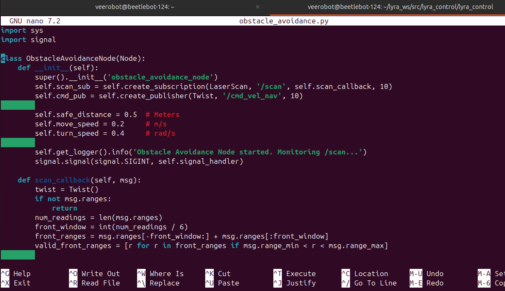

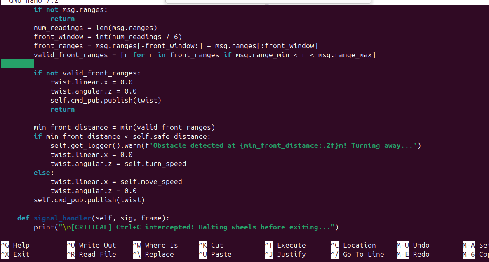

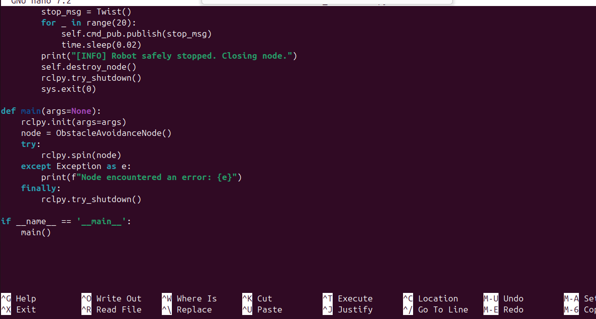

**Step 3: Save the Script and Make It Executable**

**Command**

```bash
Ctrl+O, Enter
Ctrl+X
chmod +x obstacle_avoidance.py
```

**Explanation**

Ctrl+O followed by Enter saves the file under its existing name (obstacle_avoidance.py), and Ctrl+X exits nano. The chmod +x command sets the executable permission on the script, which is required for a ROS 2 Python node referenced by a console_scripts entry point.

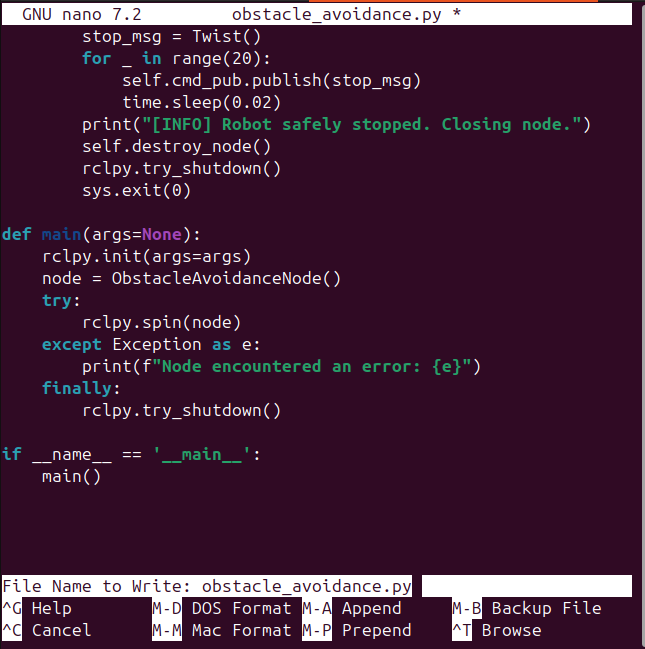

**Step 4: Register the Entry Point in setup.py**

**Command**

```bash
cd ~/lyra_ws/src/lyra_control/
nano setup.py
'obstacle_avoid = lyra_control.obstacle_avoidance:main',
```

**Explanation**

The package root contains setup.py. Inside entry_points → console_scripts, the line obstacle_avoid = lyra_control.obstacle_avoidance:main is added. This registers obstacle_avoid as a command name that points to the main() function of the obstacle_avoidance module, which allows the node to be launched using ros2 run lyra_control obstacle_avoid. The existing cmd_vel_mux and joy_teleop_wrapper entries are left unchanged.

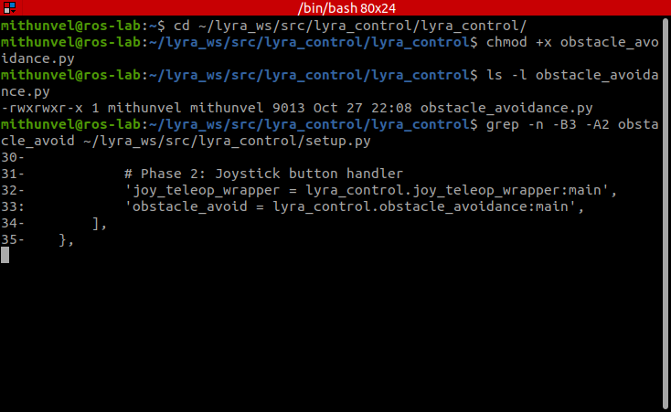

<p style="text-align:center"><em>Making obstacle_avoidance.py executable and the obstacle_avoid entry point in setup.py. Simulated: captured from the lyra_sim emulator (no robot hardware).</em></p>

**Step 5: Build the Package and Launch the Node**

**Command**

```bash
ssh veerobot@192.168.0.124
cd ~/lyra_ws
colcon build --packages-select lyra_control
source install/setup.bash
ros2 run lyra_control obstacle_avoid
```

**Explanation**

The ssh command reconnects to the robot for the build-and-run session. The colcon build --packages-select lyra_control command compiles only the lyra_control package instead of the whole workspace, which is faster during development; the log confirms "Finished <<< lyra_control". The workspace is then re-sourced so that the newly built obstacle_avoid entry point is available.

The ros2 run command launches the node, which prints "Obstacle Avoidance Node started.

Monitoring /scan..." followed by "Obstacle detected at 0.40m! Turning away..." as soon as the LiDAR detects an object within the 0.5 m safe distance.

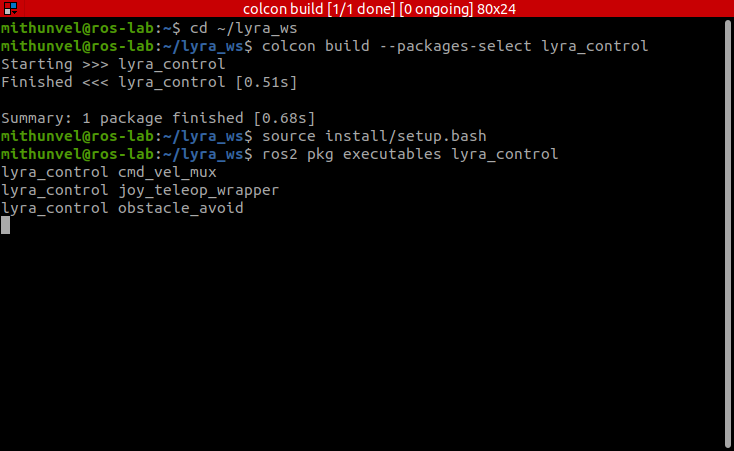

<p style="text-align:center"><em>Building lyra_control and listing its executables (obstacle_avoid present). Simulated: captured from the lyra_sim emulator (no robot hardware).</em></p>

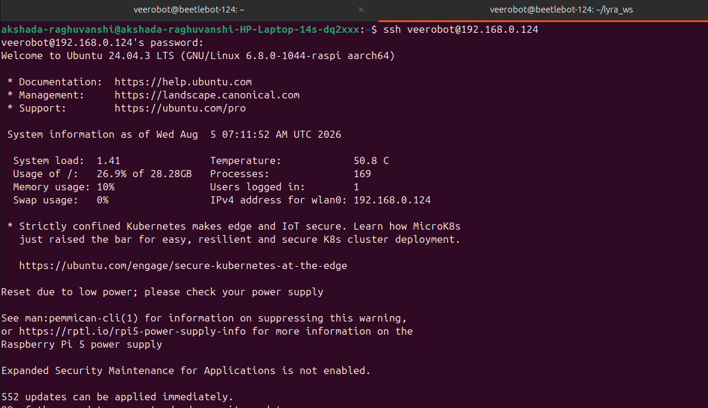

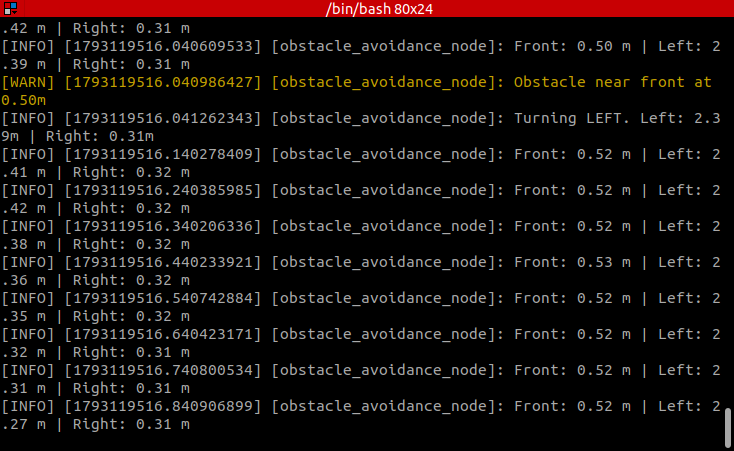

<p style="text-align:center"><em>obstacle_avoid running: scan readings and turn-away decisions. Simulated: captured from the lyra_sim emulator (no robot hardware).</em></p>

**Step 6: Stop the Robot Safely**

**Command**

```bash
Ctrl+C
ros2 service call /lyra/disarm std_srvs/srv/Trigger
```

**Explanation**

Pressing Ctrl+C in the node's terminal triggers the SIGINT signal handler, which publishes 20 zero-velocity Twist messages (about 0.4 s at 50 Hz) before the node exits, so the wheels are explicitly halted. The disarm service call can be used as a global software stop if needed. Since the node also publishes a zero-velocity command whenever no valid front readings are available, a momentary LiDAR dropout causes the robot to stop rather than drive blind.

### RESULT

The obstacle_avoidance.py node was written, made executable, and registered as the obstacle_avoid console-script entry point in the lyra_control package. The package was built using colcon build and launched with ros2 run lyra_control obstacle_avoid. The node continuously processed the LiDAR /scan data, correctly detected obstacles within the 0.5 m safe distance (at approximately 0.40–0.46 m), and published turn-away velocity commands to /cmd_vel_nav. The experiment demonstrated a working reactive obstacle avoidance control loop on the physical BeetleBot using ROS 2.

| **Evaluation Rubrics** | | |
| :-: | :-: | :-: |
| **Objective (s)/ Tools Required/ Procedure** | **01** | |
| **Conducting Experiments / Data Collection / Calculation** | **05** | |
| **Results** | **01** | |
| **Inference / Understanding / Quiz** | **03** | |
| **Total** | **10** | |
| **Faculty Signature with Date** | | |

<div class="pagebreak"></div>

## EXP 5: Colour Detection and Tracking with BeetleBot Using ROS 2 Jazzy and OpenCV

### AIM

To develop and test a ROS 2 node on the BeetleBot (Lyra) mobile robot that detects colours in the live camera feed (/pi_camera/image_raw) using OpenCV and converts them into motion commands: GREEN for forward motion, RED for stop, and BLUE for backward motion.

### PRINCIPLE

In a reactive (behaviour-based) controller, the robot maps what it currently senses directly to an action, without a map or long-term plan. Here the sensor is the camera and the action is a velocity command. Each camera frame is converted from a ROS sensor_msgs/msg/Image message into an OpenCV image in BGR format using cv_bridge. To focus on the object directly in front of the robot, only the central region of interest (the middle 50% of the image width and height) is analysed.

The region of interest is converted from the BGR colour space to the HSV (Hue, Saturation, Value) colour space, because hue is largely independent of brightness. The cv2.inRange() function creates a binary mask for each colour using lower and upper HSV limits: green (H 35–85), blue (H 90–130), and red, which wraps around the hue scale and is therefore detected using two ranges (H 0–10 and H 170–180) combined with a bitwise OR. If a colour occupies more than 20% of the region of interest, the corresponding command is selected: green drives the robot forward at 0.2 m/s, red stops it, and blue drives it backward at 0.15 m/s. When no colour is detected, the robot keeps its previous command.

ROS 2 nodes exchange data over topics. The colour-control node subscribes to the camera image topic published by the camera node and publishes geometry_msgs/msg/Twist velocity commands that drive the robot base. Services are used for one-off request/response actions; the robot exposes the /lyra/arm and /lyra/disarm services of type std_srvs/srv/Trigger.

For safety, the Lyra software stack starts in a DISARMED state. A node named cmd_vel_gate sits between the command sources (joystick, navigation, and user nodes) and the motor driver, and passes velocity commands to the wheels only while the robot is armed. The current state is published on the /lyra/armed topic (std_msgs/msg/Bool). Consequently, a controller can be running and publishing correctly, yet the wheels will not move until the robot is armed.

### MATERIALS REQUIRED

- BeetleBot (Lyra) differential-drive mobile robot with wheel encoders
- Raspberry Pi 5 onboard computer (Ubuntu 24.04 LTS)
- OV5647 Pi camera (streamed at 320×240, BGR888)
- SLLidar LiDAR and IMU
- Laptop connected to the same Wi-Fi network
- Red, green, and blue coloured cards

### SOFTWARE USED

- ROS 2 Jazzy
- Python 3 (rclpy)
- OpenCV (cv2), cv_bridge and NumPy
- Colcon Build System
- nano Text Editor
- SSH and SCP
- Terminal

### PROCEDURE

**Step 1: Connect to the Robot and Launch the Base Stack**

**Command**

```bash
ssh veerobot@192.168.0.129
source /opt/ros/jazzy/setup.bash
source ~/lyra_ws/install/setup.bash
ros2 launch lyra_bringup robot.launch.py mode:=slam camera:=true imu:=true
```

**Explanation**

From the laptop, a remote session is opened on the robot's Raspberry Pi using SSH. The ROS 2 Jazzy environment and the Lyra workspace are sourced, and the bringup launch file is started in SLAM mode with the camera and IMU enabled. It starts the robot state publisher, wheel odometry, IMU filter, EKF, camera node, and the command-velocity gate. The log confirms that the gate is active and that the robot starts in the DISARMED state.

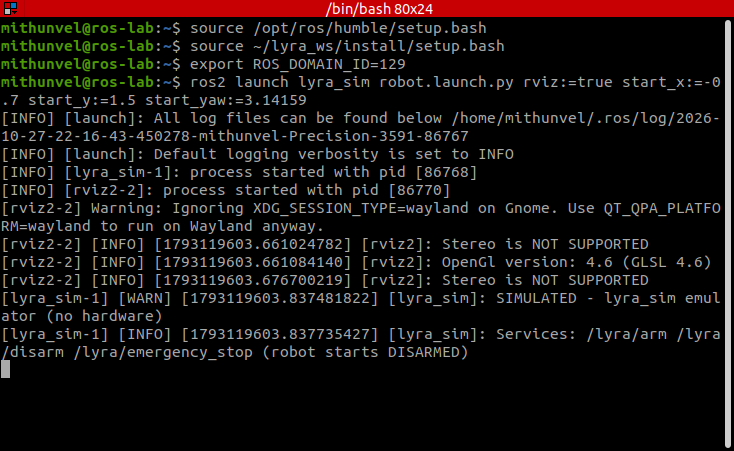

<p style="text-align:center"><em>Starting the BeetleBot emulator (ROS_DOMAIN_ID=129). Simulated: captured from the lyra_sim emulator (no robot hardware).</em></p>

**Step 2: Confirm That the Camera and LiDAR Are Ready**

**Explanation**

The launch continues through four stages: base robot, camera, LiDAR, and SLAM Toolbox. The camera is configured at 320×240 and the LiDAR reports health status OK, after which the stack prints "LYRA ROBOT READY - SLAM MODE". A missing camera calibration file is reported as a warning; this does not affect colour detection, which uses raw pixel values.

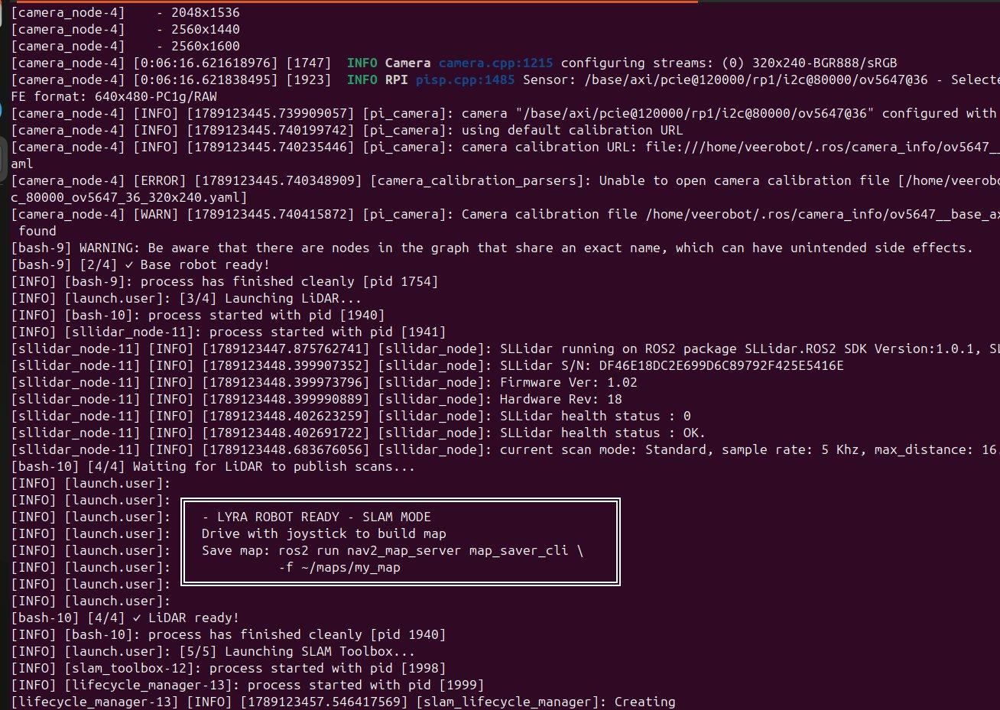

**Step 3: Verify the Available Topics**

**Command**

```bash
ros2 topic list
```

**Explanation**

In a second terminal (logged in to the robot through SSH), the topic list is checked to ensure that the sensor data is available. The key topics for this experiment are /pi_camera/image_raw (camera images, the input to the colour-detection node), /cmd_vel (velocity commands to the robot base through the gate), /lyra/armed (Boolean arm state of the robot), /scan (LiDAR scan data used by SLAM Toolbox), and /imu/data, /wheel/odom, and /odometry/filtered (IMU, wheel odometry, and EKF-fused odometry).

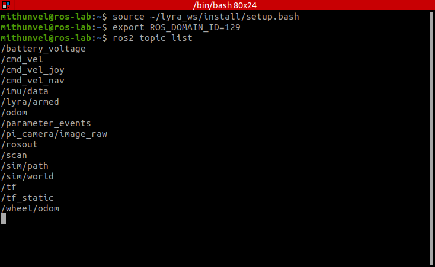

<p style="text-align:center"><em>Active topics, including /pi_camera/image_raw. Simulated: captured from the lyra_sim emulator (no robot hardware).</em></p>

**Step 4: Create the Colour-Detection Package**

**Command**

```bash
mkdir -p ~/lyra_ws/src && cd ~/lyra_ws/src
ros2 pkg create color_detection --build-type ament_python \
--dependencies rclpy sensor_msgs geometry_msgs cv_bridge
```

**Explanation**

A new ament_python package named color_detection is created inside the workspace source folder, with the dependencies needed for image processing and motion commands. This generates package.xml, setup.py, setup.cfg, the color_detection/ Python module folder, and the standard test files. The licence warning shown is only a reminder to replace the TODO placeholder and is harmless.

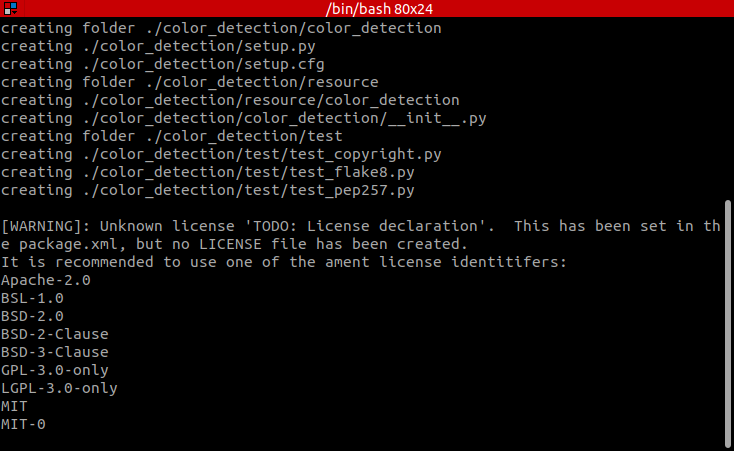

<p style="text-align:center"><em>Creating the color_detection package. Captured on the lab laptop, ROS 2 Humble.</em></p>

**Step 5: Transfer the Control Script to the Robot**

**Command**

```bash
find ~ -iname "color_detection_beetlebot.txt"
scp ~/Downloads/color_detection_beetlebot.txt \
veerobot@192.168.0.129:~/lyra_ws/src/color_detection/color_detection/color_control.py
```

**Explanation**

The control program, written on the laptop as color_detection_beetlebot.txt, is located using find and copied to the robot with scp (secure copy), from a laptop terminal, where it is saved as color_control.py inside the package. The transfer completes at 100% (5877 bytes).

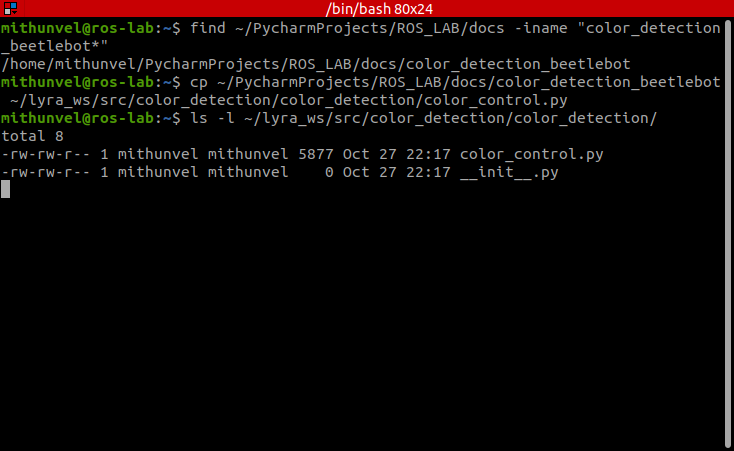

<p style="text-align:center"><em>Locating the control script and copying it into the package (cp used instead of scp, as no robot is involved). Captured on the lab laptop, ROS 2 Humble.</em></p>

**Code**

```python
import rclpy
from rclpy.node import Node

from sensor_msgs.msg import Image
from geometry_msgs.msg import Twist

from cv_bridge import CvBridge
import cv2
import numpy as np

class ColorControlNode(Node):

    def __init__(self):
        super().__init__('color_control_node')

        self.camera_sub = self.create_subscription(
            Image,
            '/pi_camera/image_raw',
            self.camera_callback,
            10
        )

        self.cmd_pub = self.create_publisher(
            Twist,
            '/cmd_vel_nav',
            10
        )

        self.bridge = CvBridge()

        self.forward_speed = 0.2
        self.reverse_speed = 0.15

        # 1 = FORWARD
        # 0 = STOP
        # -1 = BACKWARD
        #
        # Initially stopped for safety
        self.last_command = 0

        self.get_logger().info(
            'COLOR CONTROL STARTED'
        )

        self.get_logger().info(
            'GREEN = FORWARD | RED = STOP | BLUE = BACKWARD'
        )

    def camera_callback(self, msg):

        try:
            frame = self.bridge.imgmsg_to_cv2(
                msg,
                desired_encoding='bgr8'
            )

        except Exception as e:
            self.get_logger().error(
                f'Camera conversion error: {e}'
            )
            return

        # ------------------------------------------------
        # CENTER REGION OF CAMERA IMAGE
        # ------------------------------------------------

        height, width = frame.shape[:2]

        x1 = int(width * 0.25)
        x2 = int(width * 0.75)

        y1 = int(height * 0.25)
        y2 = int(height * 0.75)

        roi = frame[y1:y2, x1:x2]

        # ------------------------------------------------
        # BGR → HSV
        # ------------------------------------------------

        hsv = cv2.cvtColor(
            roi,
            cv2.COLOR_BGR2HSV
        )

        # =================================================
        # GREEN → FORWARD
        # =================================================

        green_lower = np.array([35, 80, 60])
        green_upper = np.array([85, 255, 255])

        green_mask = cv2.inRange(
            hsv,
            green_lower,
            green_upper
        )

        # =================================================
        # RED → STOP
        # =================================================

        red_lower1 = np.array([0, 100, 80])
        red_upper1 = np.array([10, 255, 255])

        red_lower2 = np.array([170, 100, 80])
        red_upper2 = np.array([180, 255, 255])

        red_mask1 = cv2.inRange(
            hsv,
            red_lower1,
            red_upper1
        )

        red_mask2 = cv2.inRange(
            hsv,
            red_lower2,
            red_upper2
        )

        red_mask = red_mask1 | red_mask2

        # =================================================
        # BLUE → BACKWARD
        # =================================================

        blue_lower = np.array([90, 80, 60])
        blue_upper = np.array([130, 255, 255])

        blue_mask = cv2.inRange(
            hsv,
            blue_lower,
            blue_upper
        )

        # ------------------------------------------------
        # COLOR PERCENTAGES
        # ------------------------------------------------

        total_pixels = roi.shape[0] * roi.shape[1]

        green_percentage = (
            cv2.countNonZero(green_mask)
            / total_pixels
        )

        red_percentage = (
            cv2.countNonZero(red_mask)
            / total_pixels
        )

        blue_percentage = (
            cv2.countNonZero(blue_mask)
            / total_pixels
        )

        # ------------------------------------------------
        # COLOR DECISION
        # ------------------------------------------------

        threshold = 0.20

        # GREEN → FORWARD
        if green_percentage > threshold:

            if self.last_command != 1:
                self.get_logger().info(
                    'GREEN detected → FORWARD'
                )

            self.last_command = 1

        # RED → STOP
        elif red_percentage > threshold:

            if self.last_command != 0:
                self.get_logger().info(
                    'RED detected → STOP'
                )

            self.last_command = 0

        # BLUE → BACKWARD
        elif blue_percentage > threshold:

            if self.last_command != -1:
                self.get_logger().info(
                    'BLUE detected → BACKWARD'
                )

            self.last_command = -1

        # ------------------------------------------------
        # NO COLOR
        #
        # DO NOTHING.
        #
        # The robot keeps its previous command.
        # ------------------------------------------------

        # ------------------------------------------------
        # MOVEMENT COMMAND
        # ------------------------------------------------

        twist = Twist()

        if self.last_command == 1:

            # FORWARD
            twist.linear.x = self.forward_speed
            twist.angular.z = 0.0

        elif self.last_command == -1:

            # BACKWARD
            twist.linear.x = -self.reverse_speed
            twist.angular.z = 0.0

        else:

            # STOP
            twist.linear.x = 0.0
            twist.angular.z = 0.0

        self.cmd_pub.publish(twist)

def main(args=None):

    rclpy.init(args=args)

    node = ColorControlNode()

    try:
        rclpy.spin(node)

    except KeyboardInterrupt:
        pass

    finally:

        # SAFETY STOP
        stop = Twist()

        for _ in range(10):
            node.cmd_pub.publish(stop)

        node.destroy_node()
        rclpy.shutdown()

if __name__ == '__main__':
    main()
```

**Explanation**

The node's \_\_init\_\_ method subscribes to /pi_camera/image_raw and creates a publisher on /cmd_vel_nav. It sets forward_speed = 0.2 m/s and reverse_speed = 0.15 m/s, and initializes last_command to 0 (stop) for safety.

On every incoming image, camera_callback converts the ROS image into an OpenCV BGR frame using CvBridge, crops the central region of interest, and converts it to HSV. Binary masks are created for green, red (two hue ranges combined), and blue, and the percentage of pixels in each mask is calculated.

If green covers more than 20% of the region, last_command is set to 1 (forward); if red does, it is set to 0 (stop); if blue does, it is set to -1 (backward). A log message is printed only when the command changes. A Twist message is then published with linear.x = 0.2, 0.0, or -0.15 m/s according to last_command. If no colour is detected, the previous command is retained.

In main(), the node is spun until Ctrl+C is pressed. The finally block publishes ten zero-velocity Twist messages before the node is destroyed, ensuring that the robot comes to a complete stop.

**Step 6: Register the Executable and Build the Package**

**Command**

```bash
nano ~/lyra_ws/src/color_detection/setup.py
'color_control = color_detection.color_control:main',
cd ~/lyra_ws
colcon build --packages-select color_detection
source install/setup.bash
ros2 pkg executables color_detection
ros2 topic echo /lyra/armed --once
```

**Explanation**

The setup.py file is edited so that the script is exposed as the ROS 2 executable color_control, by adding the entry point color_control = color_detection.color_control:main under console_scripts. The package is then built and the workspace sourced. The build finishes in about 3 s, and ros2 pkg executables lists color_detection color_control, confirming that the node is registered. Reading the first lines of the file confirms that the script was transferred correctly. The arm state is checked with ros2 topic echo /lyra/armed --once, which returns data: false (robot disarmed).


<p style="text-align:center"><em>Registering color_control in setup.py, building, and listing the executable. Captured on the lab laptop, ROS 2 Humble.</em></p>

**Step 7: Arm the Robot**

**Command**

```bash
ros2 service type /lyra/arm
ros2 service call /lyra/arm std_srvs/srv/Trigger {}
ros2 topic echo /lyra/armed --once
ros2 service call /lyra/disarm std_srvs/srv/Trigger {}
```

**Explanation**

Because the cmd_vel_gate blocks motion while the robot is disarmed, the robot is armed through the Trigger service. The service type is first confirmed, the arm service is called, and /lyra/armed is read back. The arm call returns success=True with the message "ARM command sent", and /lyra/armed changes to true. The disarm service works in the same way and is used as the manual safety stop at the end of every test.


<p style="text-align:center"><em>Checking /lyra/armed and arming the robot. Simulated: captured from the lyra_sim emulator (no robot hardware).</em></p>

**Step 8: Run the Colour-Control Node**

**Command**

```bash
ros2 run color_detection color_control
```

**Explanation**

With the robot armed, the node is started in a separate terminal. It prints its start-up banner "GREEN = FORWARD | RED = STOP | BLUE = BACKWARD" and then logs a message each time the detected colour changes. Coloured cards are shown to the camera in turn, and the robot's response is observed.


<p style="text-align:center"><em>color_control running: a green object is detected and the robot drives FORWARD. Simulated: captured from the lyra_sim emulator (no robot hardware).</em></p>

**Step 9: Observe the Colour Responses**

**Explanation**

When a green card is shown, the node logs "GREEN detected → FORWARD" and the robot moves forward. When a red card is shown, it logs "RED detected → STOP" and the robot halts. When a blue card is shown, it logs "BLUE detected → BACKWARD" and the robot reverses. The sequence of GREEN, BLUE, and RED detections in the log matches the order in which the cards are presented, and a new command is reported as soon as the colour in view changes. With /lyra/armed = false, the robot does not move even though the node is running; it responds only after the arm service call.

**Step 10: Stop the Robot Safely**

**Command**

```bash
Ctrl+C
ros2 service call /lyra/disarm std_srvs/srv/Trigger {}
```

**Explanation**

Pressing Ctrl+C stops the node, and the finally block publishes zero-velocity commands so that the wheels are halted. The disarm service call disables the motors at the end of the experiment.

### RESULT

A colour-based reactive controller was successfully implemented on the BeetleBot using ROS 2 Jazzy and OpenCV. The robot stack was brought up remotely, the sensor topics were verified, and a new color_detection package was created, built, and run. The robot responded correctly to GREEN (forward), RED (stop), and BLUE (backward), with every colour change reported in the log. The experiment also demonstrated the importance of the arm/disarm safety gate and of correct file transfer and workspace sourcing when deploying code to an embedded robot.

| **Evaluation Rubrics** | | |
| :-: | :-: | :-: |
| **Objective (s)/ Tools Required/ Procedure** | **01** | |
| **Conducting Experiments / Data Collection / Calculation** | **05** | |
| **Results** | **01** | |
| **Inference / Understanding / Quiz** | **03** | |
| **Total** | **10** | |
| **Faculty Signature with Date** | | |

<div class="pagebreak"></div>

## EXP 6: IR Sensor-Based Line Following of a 4WD Arduino Mobile Robot

### AIM

To program a 4WD Arduino mobile robot to autonomously follow a black line on a light-coloured floor using a three-channel infrared (IR) line tracking sensor module and an L298N-type motor driver.

### PRINCIPLE

Line following is one of the simplest forms of autonomous navigation, in which a robot follows a predefined path marked on the floor. An IR line tracking sensor consists of an infrared LED and a photodiode/phototransistor. Light-coloured surfaces reflect most of the infrared light back to the receiver, while a black line absorbs it. The sensor output therefore changes depending on whether it is above the line or the floor.

The robot uses three IR sensors (left, middle, and right) mounted under the front of the chassis and connected to digital pins 2, 4, and 10 of the Arduino. Each reading is inverted (!digitalRead) so that a value of 1 indicates that the sensor is above the black line.

The four DC motors are driven through a dual H-bridge motor driver. The ENA and ENB pins receive PWM signals (analogWrite) to set the motor speed, and the IN1–IN4 pins set the direction of rotation of the left and right motor pairs. The robot turns by rotating the wheels on both sides in opposite directions (differential/skid steering).

The control logic is as follows: if the middle sensor detects the line, the robot moves forward; if the right sensor detects the line, the robot turns right until the line is centred again; if the left sensor detects the line, the robot turns left; and if no sensor detects the line, the robot stops.

### MATERIALS REQUIRED

- 4WD Arduino Smart Robot Car (Arduino Uno with sensor shield)
- Three-channel IR line tracking sensor module
- Motor driver module and four DC geared motors
- Battery pack
- USB cable
- Black insulation tape for the track
- Laptop/Desktop

### SOFTWARE USED

- Arduino IDE
- Serial Monitor

### PROCEDURE

**Step 1: Verify the Hardware Connections**

**Explanation**

The robot chassis, motors, battery pack, and Arduino board with the sensor shield are checked. The left, middle, and right IR sensors are connected to digital pins 2, 4, and 10. The motor driver is connected to ENA (pin 6), ENB (pin 5), IN1 (pin 7), IN2 (pin 8), IN3 (pin 9), and IN4 (pin 11).


**Step 2: Prepare the Track**

**Explanation**

A closed path with straight sections and curves is made on the light-coloured floor using black insulation tape. The width of the tape is sufficient for the middle sensor to detect the line while the side sensors remain on the floor when the robot is centred.

**Step 3: Configure the Arduino IDE**

**Command**

```text
Tools → Board → Arduino Uno
Tools → Port → (COM port of the robot)
```

**Explanation**

The robot is connected to the laptop using the USB cable. In the Arduino IDE, the board type and the communication port are selected so that the program can be uploaded to the robot's Arduino Uno.

**Step 4: Write the Line Following Program**

**Code**

```cpp
//Line Tracking IO define
#define LT_R !digitalRead(10)
#define LT_M !digitalRead(4)
#define LT_L !digitalRead(2)

#define ENB 5
#define IN1 7
#define IN2 8
#define IN3 9
#define IN4 11
#define ENA 6

#define carSpeed 150

void back(){
  analogWrite(ENA, carSpeed);
  analogWrite(ENB, carSpeed);
  digitalWrite(IN1, HIGH);
  digitalWrite(IN2, LOW);
  digitalWrite(IN3, LOW);
  digitalWrite(IN4, HIGH);
  Serial.println("go forward!");
}

void forward(){
  analogWrite(ENA, carSpeed);
  analogWrite(ENB, carSpeed);
  digitalWrite(IN1, LOW);
  digitalWrite(IN2, HIGH);
  digitalWrite(IN3, HIGH);
  digitalWrite(IN4, LOW);
  Serial.println("go back!");
}

void left(){
  analogWrite(ENA, carSpeed);
  analogWrite(ENB, carSpeed);
  digitalWrite(IN1, LOW);
  digitalWrite(IN2, HIGH);
  digitalWrite(IN3, LOW);
  digitalWrite(IN4, HIGH);
  Serial.println("go left!");
}

void right(){
  analogWrite(ENA, carSpeed);
  analogWrite(ENB, carSpeed);
  digitalWrite(IN1, HIGH);
  digitalWrite(IN2, LOW);
  digitalWrite(IN3, HIGH);
  digitalWrite(IN4, LOW);
  Serial.println("go right!");
}

void stop(){
   digitalWrite(ENA, LOW);
   digitalWrite(ENB, LOW);
   Serial.println("Stop!");
}

void setup(){
  Serial.begin(9600);
}

void loop() {
  if(LT_M){
    forward();
  }
  else if(LT_R) {
    right();
    while(LT_R);
  }
  else if(LT_L) {
    left();
    while(LT_L);
  }
  else {
    // If no sensors (Middle, Right, or Left) see the black line, stop the car
    stop();
  }
}
```

**Explanation**

The #define statements assign the IR sensor inputs and the motor driver pins, and set the motor speed (carSpeed = 150 out of 255). The functions forward(), back(), left(), right(), and stop() set the direction pins and the PWM speed for each motion; the Serial.println() calls print the current motion for monitoring.

In loop(), the middle sensor is checked first, and the robot moves forward while it is above the line. If the right sensor detects the line, the robot turns right, and the while(LT_R); statement keeps it turning until the right sensor leaves the line. The left turn works in the same way. If none of the sensors detects the line, the robot stops.

**Step 5: Upload the Program**

**Command**

```text
Sketch → Verify/Compile
Sketch → Upload
```

**Explanation**

The program is compiled to check for errors and then uploaded to the Arduino Uno. After uploading, the USB cable is disconnected and the robot is powered using the battery pack.

**Step 6: Run the Robot on the Track**

**Explanation**

The robot is placed on the track with the middle sensor above the black line and switched on. The robot moves forward along the straight sections and corrects its direction at the curves by turning left or right whenever a side sensor detects the line.


### RESULT

The line following program was written and uploaded to the 4WD Arduino mobile robot. Using the three IR sensors, the robot detected the black line, moved forward when the line was under the middle sensor, and turned left or right to correct its path when the line was detected by a side sensor. The robot successfully followed the black line track, including the curved sections, demonstrating IR sensor-based autonomous line following.

| **Evaluation Rubrics** | | |
| :-: | :-: | :-: |
| **Objective (s)/ Tools Required/ Procedure** | **01** | |
| **Conducting Experiments / Data Collection / Calculation** | **05** | |
| **Results** | **01** | |
| **Inference / Understanding / Quiz** | **03** | |
| **Total** | **10** | |
| **Faculty Signature with Date** | | |

<div class="pagebreak"></div>

## EXP 7: Line Following with Ultrasonic Obstacle Avoidance of a 4WD Arduino Mobile Robot

### AIM

To program a 4WD Arduino mobile robot to follow a black line using IR line tracking sensors, and to detect obstacles on its path using an HC-SR04 ultrasonic sensor so that the robot stops before colliding with an obstacle and resumes line following once the path is clear.

### PRINCIPLE

This experiment combines IR sensor-based line following with ultrasonic obstacle detection. The IR line tracking sensors guide the robot along the black line, while the ultrasonic sensor, mounted on a servo motor at the front of the robot, continuously measures the distance to any object ahead.

The HC-SR04 ultrasonic sensor works on the time-of-flight principle. A 10 µs pulse on the TRIG pin causes the sensor to emit an ultrasonic burst at 40 kHz. The ECHO pin then stays HIGH for the time taken by the sound wave to travel to the object and back. The distance is calculated as Distance = (Time × Speed of sound) / 2. With the speed of sound taken as 343 m/s (0.0343 cm/µs), this reduces to Distance (cm) ≈ Time (µs) / 58.

The servo motor is set to 90° so that the ultrasonic sensor faces straight ahead along the line. In every control cycle, the distance is measured first. If an obstacle is detected within the safe distance of 20 cm, the robot stops and waits. Once the obstacle is removed, the robot resumes line following using the same left–middle–right sensor logic as in the previous experiment. A timeout is used in pulseIn() so that the program does not block when no echo is received.

### MATERIALS REQUIRED

- 4WD Arduino Smart Robot Car (Arduino Uno with sensor shield)
- Three-channel IR line tracking sensor module
- HC-SR04 ultrasonic sensor mounted on an SG90 servo motor
- Motor driver module and four DC geared motors
- Battery pack
- USB cable
- Black insulation tape for the track
- Obstacle (box or any solid object)
- Laptop/Desktop

### SOFTWARE USED

- Arduino IDE
- Servo library
- Serial Monitor

### PROCEDURE

**Step 1: Verify the Hardware Connections**

**Explanation**

In addition to the IR sensor and motor driver connections used in the previous experiment, the ultrasonic sensor's ECHO pin is connected to A4 and TRIG pin to A5, and the servo motor signal wire is connected to digital pin 3. The ultrasonic sensor is mounted on the servo at the front of the robot.


**Step 2: Write the Line Following and Obstacle Avoidance Program**

**Code**

```cpp
#include <Servo.h>

//Line Tracking IO define
#define LT_R !digitalRead(10)
#define LT_M !digitalRead(4)
#define LT_L !digitalRead(2)

//Motor driver pins
#define ENB 5
#define IN1 7
#define IN2 8
#define IN3 9
#define IN4 11
#define ENA 6

//Ultrasonic sensor and servo pins
#define ECHO A4
#define TRIG A5
#define SERVO_PIN 3

#define carSpeed 150
#define safeDistance 20   // stopping distance in cm

Servo myservo;

void forward(){
  analogWrite(ENA, carSpeed);
  analogWrite(ENB, carSpeed);
  digitalWrite(IN1, LOW);
  digitalWrite(IN2, HIGH);
  digitalWrite(IN3, HIGH);
  digitalWrite(IN4, LOW);
  Serial.println("go forward!");
}

void left(){
  analogWrite(ENA, carSpeed);
  analogWrite(ENB, carSpeed);
  digitalWrite(IN1, LOW);
  digitalWrite(IN2, HIGH);
  digitalWrite(IN3, LOW);
  digitalWrite(IN4, HIGH);
  Serial.println("go left!");
}

void right(){
  analogWrite(ENA, carSpeed);
  analogWrite(ENB, carSpeed);
  digitalWrite(IN1, HIGH);
  digitalWrite(IN2, LOW);
  digitalWrite(IN3, HIGH);
  digitalWrite(IN4, LOW);
  Serial.println("go right!");
}

void stop(){
  digitalWrite(ENA, LOW);
  digitalWrite(ENB, LOW);
  Serial.println("Stop!");
}

//Measure the distance (cm) to the object in front of the robot
int getDistance(){
  digitalWrite(TRIG, LOW);
  delayMicroseconds(2);
  digitalWrite(TRIG, HIGH);
  delayMicroseconds(10);
  digitalWrite(TRIG, LOW);
  long duration = pulseIn(ECHO, HIGH, 20000);   // 20 ms timeout
  if (duration == 0) {
    return 400;                                  // no echo: path is clear
  }
  return (int)(duration / 58);                   // time (us) to distance (cm)
}

void setup(){
  Serial.begin(9600);
  pinMode(ECHO, INPUT);
  pinMode(TRIG, OUTPUT);
  pinMode(IN1, OUTPUT);
  pinMode(IN2, OUTPUT);
  pinMode(IN3, OUTPUT);
  pinMode(IN4, OUTPUT);
  pinMode(ENA, OUTPUT);
  pinMode(ENB, OUTPUT);
  myservo.attach(SERVO_PIN);
  myservo.write(90);          // point the ultrasonic sensor straight ahead
  delay(500);
}

void loop() {
  int distance = getDistance();

  //Obstacle on the line: stop and wait until it is removed
  if (distance <= safeDistance) {
    stop();
    Serial.print("Obstacle detected at ");
    Serial.print(distance);
    Serial.println(" cm");
    return;
  }

  //Path clear: follow the black line
  if(LT_M){
    forward();
  }
  else if(LT_R) {
    right();
  }
  else if(LT_L) {
    left();
  }
  else {
    // If no sensors (Middle, Right, or Left) see the black line, stop the car
    stop();
  }
}
```

**Explanation**

The Servo library is included to control the servo motor. The pin definitions for the IR sensors and the motor driver are the same as in the previous experiment, and the ECHO, TRIG, and servo pins are added. The safe stopping distance is set to 20 cm.

The getDistance() function sends a 10 µs trigger pulse, measures the echo pulse width using pulseIn() with a 20 ms timeout, and converts it to centimetres by dividing by 58. If no echo is received, a large value (400 cm) is returned, indicating that the path is clear.

In setup(), the sensor and motor pins are configured, and the servo is turned to 90° so that the sensor faces forward. In loop(), the distance is measured first. If it is less than or equal to 20 cm, the robot stops, prints the distance on the Serial Monitor, and skips the line following logic. Otherwise, the robot follows the line: forward when the middle sensor detects the line, right or left when a side sensor detects it, and stop when no sensor detects it. The turns are non-blocking, so the distance is checked in every cycle, even while turning.

**Step 3: Upload the Program**

**Command**

```text
Tools → Board → Arduino Uno
Tools → Port → (COM port of the robot)
Sketch → Upload
```

**Explanation**

The board and port are selected, and the program is compiled and uploaded to the Arduino Uno. The USB cable is then disconnected and the robot is powered using the battery pack.

**Step 4: Run the Robot and Place an Obstacle on the Line**

**Explanation**

The robot is placed on the black line track and switched on, and it follows the line as in the previous experiment. An obstacle is then placed on the line in front of the robot. When the measured distance falls to 20 cm or less, the robot stops before reaching the obstacle. When the obstacle is removed, the robot automatically resumes following the line.


### RESULT

The line following and obstacle avoidance program was written and uploaded to the 4WD Arduino mobile robot. The robot followed the black line using the three IR sensors, while the servo-mounted ultrasonic sensor continuously measured the distance ahead. When an obstacle was placed on the line, the robot stopped at a safe distance of about 20 cm, and it resumed line following once the obstacle was removed. The experiment demonstrated the integration of IR line tracking and ultrasonic obstacle detection for safe autonomous navigation.

| **Evaluation Rubrics** | | |
| :-: | :-: | :-: |
| **Objective (s)/ Tools Required/ Procedure** | **01** | |
| **Conducting Experiments / Data Collection / Calculation** | **05** | |
| **Results** | **01** | |
| **Inference / Understanding / Quiz** | **03** | |
| **Total** | **10** | |
| **Faculty Signature with Date** | | |

<div class="pagebreak"></div>

## EXP 8: Spawning and Autonomous Navigation of TurtleBot3 in Gazebo Using ROS 2 Humble

### AIM

To create a ROS 2 workspace, download and build the TurtleBot3 packages from GitHub, spawn the TurtleBot3 Burger robot in Gazebo and control it using keyboard teleoperation, generate a 2D map of the TurtleBot3 world using Cartographer SLAM, save the map, and use it for autonomous navigation with Navigation2 (Nav2).

### PRINCIPLE

A ROS 2 workspace is a directory used to organise project files, isolate different code bases, and build custom packages together using the colcon build tool. Source code is placed in the src folder, and colcon build compiles every package inside it, creating the build, install, and log folders. Before ROS 2 commands can be used, the ROS installation and the workspace are sourced so that their packages and environment variables are loaded into the terminal.

Gazebo is a 3D robot simulator with a physics engine. The gazebo_ros package provides the interface between ROS 2 and Gazebo, including the /spawn_entity service, which inserts a robot model (described in an SDF file) into the simulation at a given position. The TURTLEBOT3_MODEL environment variable (burger, waffle, or waffle_pi) tells the launch files which robot model to load. The teleop_twist_keyboard node publishes geometry_msgs/msg/Twist messages on /cmd_vel whenever a key is pressed, and the TurtleBot3 subscribes to this topic and moves accordingly.

SLAM (Simultaneous Localization and Mapping) allows a robot to build a map of an unknown environment while estimating its own position within it. Cartographer reads the LiDAR (/scan), odometry (/odom), and TF data, estimates the robot's pose, and continuously builds a map. The occupancy grid node converts Cartographer's internal map into a nav_msgs/msg/OccupancyGrid message and publishes it on /map, where each cell is marked as free, occupied, or unknown. The use_sim_time:=True argument makes all nodes use the Gazebo simulation clock so that they remain synchronised.

The map is saved using the Nav2 map server as a .pgm (portable grey map) image of the occupied and free areas, and a .yaml file containing the map resolution, origin, and thresholds. Navigation2 then uses this map to localize the robot (AMCL), plan a global path to a goal, and follow it using a local controller while avoiding obstacles, enabling autonomous navigation.

### MATERIALS REQUIRED

- Laptop/Desktop with Ubuntu 22.04 LTS
- Internet connection
- Keyboard and Mouse

### SOFTWARE USED

- ROS 2 Humble
- Gazebo Classic 11 (gazebo_ros)
- TurtleBot3 and TurtleBot3 Simulations packages (GitHub)
- Cartographer SLAM
- Navigation2 (Nav2) and Nav2 Map Server
- RViz2
- Git, rosdep and Colcon Build System
- Terminal

### PROCEDURE

**Step 1: Create the ROS 2 Workspace**

**Command**

```bash
mkdir -p ~/23BMH1029/src
```

**Explanation**

mkdir creates a new directory. The -p (parent) option creates any intermediate folders that do not exist, without an error. ~ refers to the home directory, 23BMH1029 is the name of the workspace, and src is the folder that will contain the ROS packages.


**Step 2: Move into the Workspace**

**Command**

```bash
cd ~/23BMH1029
```

**Explanation**

cd (change directory) moves the terminal into the workspace folder, from which all subsequent build commands are executed.


**Step 3: Install Git**

**Command**

```bash
sudo apt update
sudo apt install git
```

**Explanation**

sudo (super user do) runs the commands with administrator privileges, and apt (Advanced Package Tool) is the Ubuntu software installer. apt update fetches the most recent package list, and apt install git installs Git, which is used to download projects from GitHub. This step can be skipped if Git is already installed.


**Step 4: Download the TurtleBot3 Packages**

**Command**

```bash
cd src
git clone -b humble https://github.com/ROBOTIS-GIT/turtlebot3.git
git clone -b humble https://github.com/ROBOTIS-GIT/turtlebot3_simulations.git
```

**Explanation**

git clone downloads (clones) an online repository to the computer, and -b humble selects the branch for ROS 2 Humble. The turtlebot3 repository contains the robot description, bringup, Cartographer, and Navigation2 packages, while turtlebot3_simulations contains the Gazebo models, worlds, and launch files. After cloning, the src folder contains the two folders turtlebot3 and turtlebot3_simulations.


**Step 5: Install All Dependencies**

**Command**

```bash
cd ..
rosdep install --from-paths src --ignore-src -r -y
```

**Explanation**

cd .. goes back one folder to the workspace root (23BMH1029). rosdep is the ROS dependency manager, which checks all packages and installs missing libraries automatically. --from-paths src looks inside src for ROS packages, --ignore-src does not install packages that are already present in the workspace, -r continues even if a dependency fails, and -y answers yes to all installation prompts.


**Step 6: Build the Workspace**

**Command**

```bash
colcon build
```

**Explanation**

colcon is the ROS 2 build system, which compiles every package inside src. After building, the build/, install/, and log/ folders are created in the workspace.


**Step 7: Source ROS 2 and the Workspace**

**Command**

```bash
source /opt/ros/humble/setup.bash
source ~/23BMH1029/install/setup.bash
```

**Explanation**

source loads a shell script into the current terminal. The first command loads the ROS 2 Humble environment and all ROS variables, and the second makes the packages built in the workspace available. These commands must be given in every new terminal window.


**Step 8: Choose the Robot Model**

**Command**

```bash
export TURTLEBOT3_MODEL=burger
```

**Explanation**

export creates an environment variable. TURTLEBOT3_MODEL is read by the TurtleBot3 launch files to select the robot model; its possible values are burger, waffle, and waffle_pi.


**Step 9: Start Gazebo**

**Command**

```bash
ros2 launch gazebo_ros gazebo.launch.py
```

**Explanation**

ros2 starts the ROS 2 command-line interface, and launch runs a launch file (written in Python, XML, or YAML) that starts multiple nodes together. gazebo_ros is the ROS package that provides the interface between ROS and Gazebo, and gazebo.launch.py starts the Gazebo server, the Gazebo client, and the ROS plugins, opening an empty world.


**Step 10: Verify the Spawn Service**

**Command**

```bash
source /opt/ros/humble/setup.bash
source ~/23BMH1029/install/setup.bash
ros2 service list | grep spawn
```

**Explanation**

In a new terminal, ros2 service list lists all ROS services. The | (pipe) operator sends the output of the first command into the second, and grep looks for lines matching the keyword spawn. The /spawn_entity service in the output confirms that Gazebo is ready to accept a robot model.


**Step 11: Spawn the TurtleBot3 Burger in Gazebo**

**Command**

```bash
ros2 run gazebo_ros spawn_entity.py -entity burger \
-file ~/23BMH1029/install/turtlebot3_gazebo/share/turtlebot3_gazebo/models/turtlebot3_burger/model.sdf \
-x 0 -y 0 -z 0.1
```

**Explanation**

run executes a specific program from a ROS package. spawn_entity.py is the Python script in gazebo_ros that inserts a robot into Gazebo. -entity burger sets the name of the robot inside Gazebo, and -file gives the location of the robot model. model.sdf is the Simulation Description Format file that Gazebo reads to construct the robot. -x and -y set the spawn coordinates, and -z sets the height above the ground. The TurtleBot3 Burger appears in the Gazebo world.


**Step 12: Control the Robot Using Keyboard Teleoperation**

**Command**

```bash
source /opt/ros/humble/setup.bash
source ~/23BMH1029/install/setup.bash
ros2 run teleop_twist_keyboard teleop_twist_keyboard
```

**Explanation**

In a new terminal, the teleoperation node is started. Each time a key is pressed, it publishes a Twist message on /cmd_vel, and the TurtleBot3 subscribes to it and moves accordingly. The keys are: i – move forward, , – move backward, j – spin left on the spot, l – spin right on the spot, u and o – move forward while turning left and right, m and . – move backward while turning, and k – stop.


**Step 13: Launch the TurtleBot3 World in Gazebo**

**Command**

```bash
source /opt/ros/humble/setup.bash
source ~/23BMH1029/install/setup.bash
export TURTLEBOT3_MODEL=burger
ros2 launch turtlebot3_gazebo turtlebot3_world.launch.py
```

**Explanation**

The previous terminals are closed and a new terminal is opened for mapping. turtlebot3_gazebo is the package containing the Gazebo worlds, robot models, and launch files. turtlebot3_world.launch.py opens Gazebo, loads the TurtleBot3 world, starts the physics engine, spawns the robot, and starts the robot state publisher and the Gazebo plugins, so that the robot is ready with its LiDAR and odometry. Unlike ros2 run, which starts only one node, ros2 launch can start multiple nodes together.


**Step 14: Start SLAM Using Cartographer**

**Command**

```bash
source ~/23BMH1029/install/setup.bash
export TURTLEBOT3_MODEL=burger
ros2 launch turtlebot3_cartographer cartographer.launch.py use_sim_time:=True
```

**Explanation**

In a new terminal, this command starts the Cartographer SLAM node. It listens to /scan, /odom, and /tf, estimates the robot's position, and continuously builds a map. turtlebot3_cartographer is the ROS package containing the Cartographer configuration files, cartographer.launch.py starts the Cartographer node with the TF connections and SLAM configuration, and use_sim_time:=True makes it use the Gazebo simulated clock instead of the laptop clock.

**Step 15: Start the Occupancy Grid Node**

**Command**

```bash
source ~/23BMH1029/install/setup.bash
ros2 launch turtlebot3_cartographer occupancy_grid.launch.py use_sim_time:=True
```

**Explanation**

In a new terminal, the occupancy grid node is started. It converts the Cartographer internal map into a nav_msgs/msg/OccupancyGrid message and publishes it on /map, so that the occupied, free, and unknown areas can be used by the rest of the system.

**Step 16: Visualize the Map in RViz2**

**Command**

```bash
source ~/23BMH1029/install/setup.bash
rviz2
```

**Explanation**

RViz2 is a visualization tool that displays the data published by ROS. Using the Add button, the following displays are added: Map (/map), RobotModel, LaserScan (/scan), TF, Odometry, and PointCloud2. The growing map and the LiDAR scan can now be seen in real time.

**Step 17: Drive the Robot to Build the Map**

**Command**

```bash
source ~/23BMH1029/install/setup.bash
ros2 run teleop_twist_keyboard teleop_twist_keyboard
```

**Explanation**

In a new terminal, the teleoperation node is started, and the robot is driven slowly around the entire TurtleBot3 world using the keyboard. As the robot moves, Cartographer adds the newly scanned areas to the map until the complete environment has been mapped.

**Step 18: Save the Map**

**Command**

```bash
source ~/23BMH1029/install/setup.bash
mkdir -p ~/maps
ros2 run nav2_map_server map_saver_cli -f ~/maps/my_world
```

**Explanation**

In a new terminal, mkdir -p ~/maps creates a maps folder in the home directory. nav2_map_server is the Navigation2 package responsible for loading, saving, and publishing maps, and map_saver_cli is the program that saves the map from the terminal. -f specifies the output file name prefix. Two files are created automatically: my_world.pgm, a greyscale image of the occupied and free areas, and my_world.yaml, which stores the map information (image name, resolution, origin, and occupied/free thresholds).


**Step 19: Start Navigation2 with the Saved Map**

**Command**

```bash
source ~/23BMH1029/install/setup.bash
export TURTLEBOT3_MODEL=burger
ros2 launch turtlebot3_navigation2 navigation2.launch.py use_sim_time:=True map:=$HOME/maps/my_world.yaml
```

**Explanation**

The Cartographer, occupancy grid, and teleoperation terminals are closed, while Gazebo is kept running. This command starts the Nav2 stack (map server, AMCL localization, planner, controller, and behaviour servers) with the saved map, and opens RViz2 with the navigation configuration.


**Step 20: Set the Initial Pose and Send a Navigation Goal**

**Explanation**

In RViz2, the 2D Pose Estimate tool is used to click and drag at the robot's actual position and heading in the map, so that AMCL can localize the robot; the LiDAR scan then aligns with the map walls. The Nav2 Goal tool is then used to click and drag at the desired goal position and orientation. Nav2 plans a global path, and the TurtleBot3 autonomously follows it to the goal while avoiding obstacles.

### RESULT

A ROS 2 workspace was created, and the TurtleBot3 packages were cloned from GitHub, their dependencies installed using rosdep, and the workspace built using colcon build. The TurtleBot3 Burger was spawned in Gazebo using the spawn_entity service and controlled using keyboard teleoperation. A 2D occupancy grid map of the TurtleBot3 world was generated using Cartographer SLAM, visualized in RViz2, and saved using the Nav2 map saver. Using the saved map, Navigation2 localized the robot and autonomously navigated it to the goals set in RViz2, demonstrating spawning, mapping, and autonomous navigation of a mobile robot in simulation using ROS 2 Humble.

| **Evaluation Rubrics** | | |
| :-: | :-: | :-: |
| **Objective (s)/ Tools Required/ Procedure** | **01** | |
| **Conducting Experiments / Data Collection / Calculation** | **05** | |
| **Results** | **01** | |
| **Inference / Understanding / Quiz** | **03** | |
| **Total** | **10** | |
| **Faculty Signature with Date** | | |

<div class="pagebreak"></div>

## EXP 9: AMR-Mounted Manipulator Pick-and-Place Simulation in Gazebo Using ROS 2 Humble

### AIM

To download and build the TurtleBot3 manipulation packages from GitHub, spawn an Autonomous Mobile Robot (AMR) with a mounted robotic arm (TurtleBot3 Waffle Pi with OpenMANIPULATOR-X) in Gazebo, and write a ROS 2 Python node that drives the AMR to an object, picks it up using the arm and gripper, carries it to a new location, and places it down.

### PRINCIPLE

Mobile manipulation combines the mobility of an AMR with the dexterity of a robotic arm, allowing a robot to pick objects at one location and place them at another, as in warehouse and service robots. In this experiment, the OpenMANIPULATOR-X, a 4-DOF arm (joint1–joint4) with a 1-DOF parallel gripper, is mounted on top of a TurtleBot3 Waffle Pi differential-drive base.

In Gazebo, the arm and gripper are controlled through ros2_control. The gazebo_ros2_control plugin loads a controller manager with three main controllers: joint_state_broadcaster, which publishes the joint states; arm_controller, a JointTrajectoryController that moves joint1–joint4 along a trajectory received through the /arm_controller/follow_joint_trajectory action; and gripper_controller, a GripperActionController that opens and closes the gripper through the /gripper_controller/gripper_cmd action. The mobile base is driven by the Gazebo differential-drive plugin, which subscribes to /cmd_vel and publishes the robot's odometry on /odom.

The arm poses are specified in joint space. The joint angles for the pre-grasp and grasp poses were calculated from the arm's forward kinematics, using the link lengths of the OpenMANIPULATOR-X and its mounting position on the base, so that the gripper reaches an object placed 0.18 m in front of the robot with the gripper pointing downwards. The base motion is closed-loop: the node uses the /odom feedback to drive a set distance and to rotate by a set angle.

The pick-and-place sequence is: move the arm to the home pose and open the gripper; drive forward to the object; lower the arm to the pre-grasp and grasp poses; close the gripper; lift the object; turn the base 90° and drive to the drop location; lower the arm and open the gripper to release the object; and return the arm to the home pose.

### MATERIALS REQUIRED

- Laptop/Desktop with Ubuntu 22.04 LTS
- Internet connection
- Keyboard and Mouse

### SOFTWARE USED

- ROS 2 Humble
- Gazebo Classic 11 (gazebo_ros)
- ros2_control and ros2_controllers (gazebo_ros2_control)
- TurtleBot3 Manipulation and TurtleBot3 Simulations packages (GitHub)
- Python 3 (rclpy)
- Git, rosdep and Colcon Build System
- nano Text Editor
- Terminal

### PROCEDURE

**Step 1: Install the Required ROS 2 Packages**

**Command**

```bash
sudo apt update
sudo apt install ros-humble-gazebo-ros-pkgs ros-humble-gazebo-ros2-control \
ros-humble-ros2-control ros-humble-ros2-controllers ros-humble-gripper-controllers \
ros-humble-dynamixel-sdk ros-humble-xacro
```

**Explanation**

These packages provide the Gazebo–ROS interface, the ros2_control framework and its Gazebo plugin, the joint trajectory and gripper controllers used to move the arm, the Dynamixel SDK used by the manipulator packages, and xacro, which is used to generate the robot description.


**Step 2: Download the TurtleBot3 Manipulation Packages**

**Command**

```bash
cd ~/23BMH1029/src
git clone -b humble https://github.com/ROBOTIS-GIT/turtlebot3_manipulation.git
ls
```

**Explanation**

The turtlebot3_manipulation repository is cloned into the workspace used in the previous experiment. It contains the description, bringup, MoveIt configuration, and teleoperation packages for the TurtleBot3 with OpenMANIPULATOR-X. The Gazebo package for the mobile manipulator (turtlebot3_manipulation_gazebo) is part of the turtlebot3_simulations repository, which was cloned in the previous experiment. ls confirms that the src folder now contains turtlebot3, turtlebot3_simulations, and turtlebot3_manipulation.


**Step 3: Install Dependencies and Build the Workspace**

**Command**

```bash
cd ~/23BMH1029
rosdep install --from-paths src --ignore-src -r -y
colcon build --symlink-install
source /opt/ros/humble/setup.bash
source ~/23BMH1029/install/setup.bash
```

**Explanation**

rosdep installs any missing dependencies of the newly added packages, and colcon build compiles the workspace. --symlink-install links the Python and launch files instead of copying them, so changes to them do not require a rebuild. The ROS installation and the workspace are then sourced.


**Step 4: Launch the AMR-Mounted Manipulator in Gazebo**

**Command**

```bash
ros2 launch turtlebot3_manipulation_gazebo gazebo.launch.py \
world:=/opt/ros/humble/share/gazebo_ros/worlds/empty.world x_pose:=0.0 y_pose:=0.0
```

**Explanation**

This launch file generates the robot description of the TurtleBot3 Waffle Pi with OpenMANIPULATOR-X from xacro, starts the robot state publisher, opens Gazebo with an empty world, spawns the mobile manipulator at the origin using spawn_entity.py, and spawns the joint_state_broadcaster, arm_controller, and gripper_controller.


**Step 5: Verify the Controllers and Topics**

**Command**

```bash
source /opt/ros/humble/setup.bash
source ~/23BMH1029/install/setup.bash
ros2 control list_controllers
ros2 topic list
```

**Explanation**

In a new terminal, ros2 control list_controllers confirms that joint_state_broadcaster, arm_controller, and gripper_controller are active. ros2 topic list confirms that /cmd_vel, /odom, /scan, /joint_states, and the arm_controller and gripper_controller topics are available.


**Step 6: Test the Arm and Gripper Manually**

**Command**

```bash
ros2 topic pub --once /arm_controller/joint_trajectory trajectory_msgs/msg/JointTrajectory \
"{joint_names: [joint1, joint2, joint3, joint4], points: [{positions: [0.0, -1.0, 0.7, 0.3], time_from_start: {sec: 2}}]}"

ros2 action send_goal /gripper_controller/gripper_cmd control_msgs/action/GripperCommand \
"{command: {position: 0.019, max_effort: 1.0}}"
```

**Explanation**

The first command publishes a single joint trajectory point to the arm controller, moving the arm to the home pose over 2 seconds. The second command sends a goal to the gripper action server to open the gripper (0.019 m); a position of -0.01 m closes it. This confirms that the arm and gripper respond to commands before the pick-and-place node is written.


**Step 7: Create the Pick-and-Place Package**

**Command**

```bash
cd ~/23BMH1029/src
ros2 pkg create --build-type ament_python amr_pick_place \
--dependencies rclpy geometry_msgs nav_msgs control_msgs trajectory_msgs
mkdir -p amr_pick_place/models
```

**Explanation**

ros2 pkg create creates a new Python package named amr_pick_place with the message and action packages it depends on. A models folder is created inside it to store the object model.


**Step 8: Create the Object Model**

**Command**

```bash
nano amr_pick_place/models/pick_box.sdf
```

**Explanation**

An SDF model of a small red cube (2.5 cm side, 20 g) is written. High friction coefficients (mu = 2.0) and contact parameters are set so that the object does not slip out of the gripper when it is lifted.


**Code**

```xml
<?xml version="1.0"?>
<sdf version="1.6">
  <model name="pick_box">
    <link name="link">
      <inertial>
        <mass>0.02</mass>
        <inertia>
          <ixx>2.1e-6</ixx><iyy>2.1e-6</iyy><izz>2.1e-6</izz>
          <ixy>0</ixy><ixz>0</ixz><iyz>0</iyz>
        </inertia>
      </inertial>
      <collision name="collision">
        <geometry><box><size>0.025 0.025 0.025</size></box></geometry>
        <surface>
          <friction><ode><mu>2.0</mu><mu2>2.0</mu2></ode></friction>
          <contact><ode><kp>1000000</kp><kd>100</kd><min_depth>0.001</min_depth><max_vel>0.1</max_vel></ode></contact>
        </surface>
      </collision>
      <visual name="visual">
        <geometry><box><size>0.025 0.025 0.025</size></box></geometry>
        <material><ambient>1 0 0 1</ambient><diffuse>1 0 0 1</diffuse></material>
      </visual>
    </link>
  </model>
</sdf>
```

**Step 9: Spawn the Object in Front of the Robot**

**Command**

```bash
ros2 run gazebo_ros spawn_entity.py -entity pick_box \
-file ~/23BMH1029/src/amr_pick_place/models/pick_box.sdf -x 0.68 -y 0.0 -z 0.0125
```

**Explanation**

The cube is spawned on the ground 0.68 m in front of the robot. After the robot drives forward 0.50 m, the cube is 0.18 m in front of it, which is within the grasp pose of the arm. -z 0.0125 places the cube's centre at half its height so that it rests on the ground.


**Step 10: Write the Pick-and-Place Node**

**Command**

```bash
cd ~/23BMH1029/src/amr_pick_place/amr_pick_place/
nano pick_and_place.py
```

**Explanation**

The pick-and-place node given below is written in the package's Python module folder.

**Code**

```python
import math

import rclpy
from rclpy.node import Node
from rclpy.action import ActionClient
from rclpy.duration import Duration

from geometry_msgs.msg import Twist
from nav_msgs.msg import Odometry
from control_msgs.action import FollowJointTrajectory, GripperCommand
from trajectory_msgs.msg import JointTrajectoryPoint

# ------------------------------------------------
# ARM POSES (joint1, joint2, joint3, joint4) in rad
# ------------------------------------------------
ARM_JOINTS = ['joint1', 'joint2', 'joint3', 'joint4']

HOME = [0.0, -1.0, 0.7, 0.3]        # arm folded above the base
PRE_GRASP = [0.0, 0.88, -0.58, 1.04]  # gripper 7 cm above the object
GRASP = [0.0, 1.18, -0.62, 0.79]      # gripper around the object

# Gripper positions (gripper_left_joint, m)
GRIPPER_OPEN = 0.019
GRIPPER_CLOSE = -0.01

# Mobile base motion
DRIVE_TO_OBJECT = 0.50   # m
DRIVE_TO_DROP = 0.30     # m
TURN_TO_DROP = math.pi / 2   # rad (90 deg left)

class PickAndPlace(Node):

    def __init__(self):
        super().__init__('amr_pick_and_place')

        self.arm_client = ActionClient(
            self,
            FollowJointTrajectory,
            '/arm_controller/follow_joint_trajectory'
        )

        self.gripper_client = ActionClient(
            self,
            GripperCommand,
            '/gripper_controller/gripper_cmd'
        )

        self.cmd_pub = self.create_publisher(Twist, '/cmd_vel', 10)

        self.odom_sub = self.create_subscription(
            Odometry,
            '/odom',
            self.odom_callback,
            10
        )

        self.x = None
        self.y = None
        self.yaw = None

        self.get_logger().info('AMR PICK AND PLACE NODE STARTED')

    # ------------------------------------------------
    # ODOMETRY
    # ------------------------------------------------
    def odom_callback(self, msg):
        p = msg.pose.pose.position
        q = msg.pose.pose.orientation
        self.x = p.x
        self.y = p.y
        self.yaw = math.atan2(
            2.0 * (q.w * q.z + q.x * q.y),
            1.0 - 2.0 * (q.y * q.y + q.z * q.z)
        )

    def wait_for_odom(self):
        while rclpy.ok() and self.yaw is None:
            rclpy.spin_once(self, timeout_sec=0.1)

    # ------------------------------------------------
    # ACTION HELPER
    # ------------------------------------------------
    def send_and_wait(self, client, goal):
        client.wait_for_server()
        send_future = client.send_goal_async(goal)
        rclpy.spin_until_future_complete(self, send_future)
        handle = send_future.result()
        if not handle.accepted:
            self.get_logger().error('Goal rejected')
            return
        result_future = handle.get_result_async()
        rclpy.spin_until_future_complete(self, result_future)

    # ------------------------------------------------
    # ARM AND GRIPPER
    # ------------------------------------------------
    def move_arm(self, positions, duration=2.0):
        goal = FollowJointTrajectory.Goal()
        goal.trajectory.joint_names = ARM_JOINTS
        point = JointTrajectoryPoint()
        point.positions = positions
        point.time_from_start = Duration(seconds=duration).to_msg()
        goal.trajectory.points = [point]
        self.send_and_wait(self.arm_client, goal)

    def gripper(self, position):
        goal = GripperCommand.Goal()
        goal.command.position = position
        goal.command.max_effort = 1.0
        self.send_and_wait(self.gripper_client, goal)

    # ------------------------------------------------
    # MOBILE BASE
    # ------------------------------------------------
    def stop_base(self):
        self.cmd_pub.publish(Twist())

    def drive(self, distance, speed=0.1):
        self.wait_for_odom()
        x0, y0 = self.x, self.y
        twist = Twist()
        twist.linear.x = speed
        while rclpy.ok() and math.hypot(self.x - x0, self.y - y0) < distance:
            self.cmd_pub.publish(twist)
            rclpy.spin_once(self, timeout_sec=0.05)
        self.stop_base()

    def turn(self, angle, speed=0.4):
        self.wait_for_odom()
        target = self.yaw + angle
        twist = Twist()
        while rclpy.ok():
            error = math.atan2(math.sin(target - self.yaw),
                               math.cos(target - self.yaw))
            if abs(error) < 0.02:
                break
            twist.angular.z = speed if error > 0 else -speed
            self.cmd_pub.publish(twist)
            rclpy.spin_once(self, timeout_sec=0.05)
        self.stop_base()

    # ------------------------------------------------
    # PICK AND PLACE SEQUENCE
    # ------------------------------------------------
    def run(self):
        self.get_logger().info('1. Home pose, open gripper')
        self.move_arm(HOME)
        self.gripper(GRIPPER_OPEN)

        self.get_logger().info('2. Driving to the object')
        self.drive(DRIVE_TO_OBJECT)

        self.get_logger().info('3. Picking the object')
        self.move_arm(PRE_GRASP)
        self.move_arm(GRASP, 1.5)
        self.gripper(GRIPPER_CLOSE)
        self.move_arm(PRE_GRASP, 1.5)
        self.move_arm(HOME)

        self.get_logger().info('4. Moving to the drop location')
        self.turn(TURN_TO_DROP)
        self.drive(DRIVE_TO_DROP)

        self.get_logger().info('5. Placing the object')
        self.move_arm(PRE_GRASP)
        self.move_arm(GRASP, 1.5)
        self.gripper(GRIPPER_OPEN)
        self.move_arm(PRE_GRASP, 1.5)
        self.move_arm(HOME)

        self.get_logger().info('PICK AND PLACE COMPLETED')

def main(args=None):

    rclpy.init(args=args)

    node = PickAndPlace()

    try:
        node.run()

    except KeyboardInterrupt:
        pass

    finally:

        # SAFETY STOP
        node.stop_base()
        node.destroy_node()
        rclpy.shutdown()

if __name__ == '__main__':
    main()
```

**Explanation**

The joint angles for the HOME, PRE_GRASP, and GRASP poses and the gripper open/close positions are defined at the top of the file. The node creates action clients for /arm_controller/follow_joint_trajectory (control_msgs/action/FollowJointTrajectory) and /gripper_controller/gripper_cmd (control_msgs/action/GripperCommand), a publisher on /cmd_vel, and a subscriber on /odom.

odom_callback stores the robot's x, y position and converts the orientation quaternion into the yaw angle. send_and_wait sends an action goal and blocks until the result is received, so that each motion finishes before the next one starts. move_arm builds a single-point joint trajectory that reaches the target joint angles in the given time, and gripper sends the target finger position with a limited effort.

drive publishes a forward velocity of 0.1 m/s until the distance travelled (from /odom) reaches the target, and turn rotates the base at 0.4 rad/s until the yaw error is less than 0.02 rad. run executes the complete pick-and-place sequence and logs each stage. In main(), the base is stopped before the node is destroyed, as a safety measure.


**Step 11: Register the Entry Point in setup.py**

**Command**

```bash
cd ~/23BMH1029/src/amr_pick_place/
nano setup.py
'pick_and_place = amr_pick_place.pick_and_place:main',
```

**Explanation**

Inside entry_points → console_scripts, the line pick_and_place = amr_pick_place.pick_and_place:main is added. This registers pick_and_place as a command that runs the main() function of the node, so it can be launched using ros2 run amr_pick_place pick_and_place.

**Step 12: Build the Package and Run the Node**

**Command**

```bash
cd ~/23BMH1029
colcon build --packages-select amr_pick_place
source install/setup.bash
ros2 run amr_pick_place pick_and_place
```

**Explanation**

The colcon build --packages-select amr_pick_place command builds only the new package, and the workspace is re-sourced so that the entry point is available. When the node runs, it logs each stage: home pose, driving to the object, picking, moving to the drop location, placing, and "PICK AND PLACE COMPLETED".


**Step 13: Observe the Pick-and-Place Operation**

**Explanation**

In Gazebo, the AMR drives forward and stops in front of the red cube. The arm lowers, the gripper closes around the cube, and the arm lifts it above the base. The robot then turns 90° to the left, drives 0.30 m to the drop location, lowers the arm, opens the gripper to release the cube on the ground, and returns the arm to the home pose.


### RESULT

The TurtleBot3 manipulation packages were cloned from GitHub and built, and the TurtleBot3 Waffle Pi with the OpenMANIPULATOR-X arm was spawned in Gazebo with its arm and gripper controllers active through ros2_control. An object was spawned in front of the robot, and a ROS 2 Python node was written using the FollowJointTrajectory and GripperCommand action clients together with odometry-based base control. The AMR drove to the object, picked it up, carried it to a new location, and placed it down, demonstrating mobile manipulation (pick-and-place) in simulation using ROS 2 Humble.

| **Evaluation Rubrics** | | |
| :-: | :-: | :-: |
| **Objective (s)/ Tools Required/ Procedure** | **01** | |
| **Conducting Experiments / Data Collection / Calculation** | **05** | |
| **Results** | **01** | |
| **Inference / Understanding / Quiz** | **03** | |
| **Total** | **10** | |
| **Faculty Signature with Date** | | |

<div class="pagebreak"></div>

## EXP 10: Demonstration – Autonomous Multi-Waypoint Navigation of the Acrux AMR Using ROS 2 Nav2

### AIM

To demonstrate autonomous navigation of the Acrux mobile robot through up to four pre-surveyed waypoints on a map, stopping and waiting at each waypoint until the operator confirms, avoiding unexpected obstacles on the way, and finally returning to the home position.

### PRINCIPLE

Autonomous navigation in ROS 2 is carried out by the Nav2 navigation stack. Localisation maintains the map → odom → base_link transform chain, the global planner computes a route on the global costmap, the local controller (DWB) follows this path while avoiding obstacles on the local costmap, and a behaviour tree handles retries and recovery actions. Goals are sent to Nav2 from a Python program using the nav2_simple_commander API.

Obstacles detected by the LiDAR (/scan) and the Intel RealSense depth camera (/camera/points) are marked on a costmap grid and inflated by the robot's radius plus a safety margin (0.55 m on the Acrux). For this reason, each waypoint must be placed with a standoff from the target, and travel lanes must be at least about 1.5 m wide.

Before navigation, a map of the environment is built using SLAM, and the home pose and waypoint poses are surveyed in the map frame. The mission logic is a ROS-free finite state machine (mission.py): IDLE → NAVIGATING → AT_WAYPOINT → NAVIGATING … → RETURNING_HOME → DONE. If navigation fails, the robot retries automatically and then enters the BLOCKED state, where the operator can retry (r), skip (s), or send the robot home (h); the mission can also be paused (p) or quit (q). Since this logic does not depend on ROS, every path through it can be tested with pytest (60 tests).

Safety is layered: costmap re-planning, a speed cap of 0.3 m/s, a collision monitor with a stop box and a slow-down box (running on the robot so that loss of Wi-Fi cannot disable it), operator commands, and finally the physical emergency stop.

### MATERIALS REQUIRED

- VEEROBOT Acrux mobile robot (approx. 0.76 × 0.80 m) with LiDAR, Intel RealSense depth camera and micro-ROS base
- Laptop with ROS 2 and nav2_simple_commander, on the same Wi-Fi network and ROS_DOMAIN_ID as the robot
- Cardboard boxes as test obstacles
- Tape for floor markers

### SOFTWARE USED

- ROS 2 Humble
- Nav2 Navigation Stack and nav2_simple_commander
- SLAM Toolbox and map_saver_cli
- micro-ROS Agent
- RViz2 and Gazebo
- Python 3 and pytest
- waypoint_mission project (mission code, configuration and tools)
- Terminal

### PROCEDURE

**Step 1: Run the Mission Unit Tests**

**Command**

```bash
cd waypoint_mission
python -m venv .venv
.venv/Scripts/activate
pip install -r requirements.txt
pytest
```

**Explanation**

A Python virtual environment is created on the PC, the required packages are installed, and the unit tests of the mission state machine are run. All 60 tests are expected to pass before the robot is used.

**Step 2: Connect to the Robot and Check Its Status**

**Command**

```bash
./acrux status
./acrux ros 'printenv ROS_DISTRO'
```

**Explanation**

From the waypoint_mission/tools/ folder, the acrux helper script checks the connection to the robot and prints the ROS 2 distribution running on it.

**Step 3: Switch the Robot to Development Mode**

**Command**

```bash
./dev-mode.sh on
./acrux ros 'ros2 node list'
```

**Explanation**

Development mode stops the robot's default demo software so that the user's nodes can be run. The node list is checked to confirm that it is empty.

**Step 4: Start the micro-ROS Agent and Test the Drive**

**Command**

```bash
./acrux drive 0.1 0 1.5
```

**Explanation**

The micro-ROS agent connects the PC-side ROS 2 graph to the robot's motor base. With the wheels lifted off the ground, the robot is commanded to move forward at 0.1 m/s for 1.5 s to verify that the drive works.

**Step 5: Check the LiDAR and Depth Camera**

**Command**

```bash
./acrux ros 'ros2 topic hz /scan'
ros2 topic hz /camera/points
```

**Explanation**

The publishing rates of the LiDAR scan and the RealSense point cloud are checked. The stability of the camera stream, the CPU load, and whether the camera detects obstacles that the LiDAR misses (such as a table edge) are noted.

**Step 6: Build and Save the Map Using SLAM**

**Command**

```bash
./acrux teleop
ros2 run nav2_map_server map_saver_cli -f <map_name>
```

**Explanation**

The robot is driven slowly around the environment using teleoperation while SLAM builds the map. Loops are closed by revisiting earlier areas, and the finished map is saved using map_saver_cli. The map, LiDAR view and camera feed are displayed on the operator dashboard.


**Step 7: Survey the Home Position and Waypoints**

**Command**

```bash
ros2 topic echo /goal_pose
ros2 topic echo /amcl_pose
```

**Explanation**

The home pose and four waypoint poses are recorded in the map frame, either by using the 2D Goal Pose tool in RViz2 and echoing /goal_pose, or by driving to each point and reading /amcl_pose. The poses (robot centre, at least 0.8 m from the target) are entered in waypoints.yaml and marked surveyed: true.


**Step 8: Set Up the Safety Layer**

**Command**

```bash
ros2 topic info /cmd_vel -v
ros2 topic list | grep cmd_vel
ros2 launch launch/safety.launch.py cmd_vel_in:=<nav2_output> cmd_vel_out:=cmd_vel
```

**Explanation**

The actual velocity command chain on the robot is identified first. The safety launch file then inserts the collision monitor between the Nav2 velocity output and the robot's cmd_vel input. It is tested by teleoperating the robot forward and placing a cardboard box in front of it; the robot must stop.

**Step 9: Run the Waypoint Mission**

**Command**

```bash
python3 mission_node.py --count N
```

**Explanation**

The mission is tested step by step, stopping at the first failure: first in Gazebo (--sim), then on the robot with its wheels lifted, then on the floor with cardboard obstacles, and finally as a rehearsal with 3 and then 4 waypoints. The --count argument sets the number of waypoints and has no default value, so the operator must always choose it explicitly.

Pressing y or Enter starts the mission and confirms each waypoint. The other operator commands are: s – skip, r – retry, p – pause/resume, h – return home, and q – quit.


**Step 10: Test Obstacle Avoidance During the Mission**

**Explanation**

During one run, a box is placed in the robot's path. The costmap marks the new obstacle and Nav2 re-plans around it; if the obstacle enters the stop box, the collision monitor halts the robot. The robot's response is observed and noted.


### RESULT

The working of the Acrux autonomous mobile robot was demonstrated. A map of the laboratory was built using SLAM, and the home position and waypoints were surveyed in the map frame. Using the Nav2 navigation stack and the waypoint mission program, the robot navigated autonomously to the waypoints, waited at each one for operator confirmation, avoided obstacles placed in its path, and returned to the home position. The demonstration showed how SLAM, localisation, path planning, a mission state machine, and a layered safety system work together for autonomous navigation of a mobile robot using ROS 2.

| **Evaluation Rubrics** | | |
| :-: | :-: | :-: |
| **Objective (s)/ Tools Required/ Procedure** | **01** | |
| **Conducting Experiments / Data Collection / Calculation** | **05** | |
| **Results** | **01** | |
| **Inference / Understanding / Quiz** | **03** | |
| **Total** | **10** | |
| **Faculty Signature with Date** | | |

**DRIVE LINK**

<https://drive.google.com/drive/folders/1iVVNKbl5wCkGAXaUdZoDqvOzTDN6pnzc?usp=drive_link>
