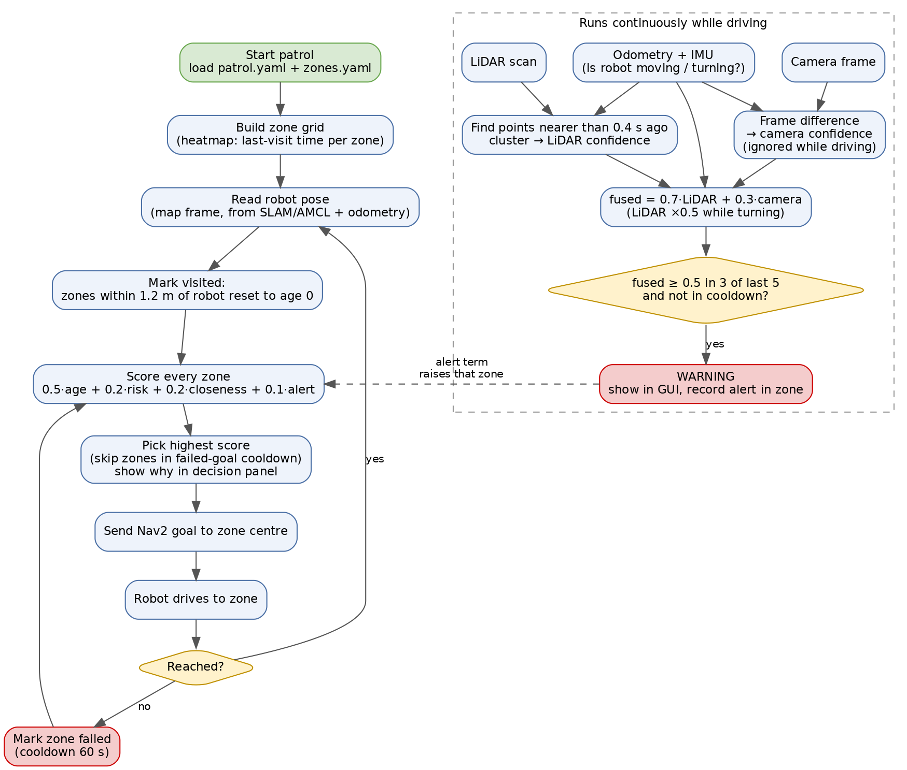

# Experiment 8 — Beetle Patrol: autonomous warehouse patrol with motion warnings (BeetleBot)

## 1. Aim
To make the BeetleBot patrol a warehouse floor on its own: divide the floor into zones, keep a *heatmap* of how long
each zone has gone unvisited, pick the next zone to patrol with a weighted priority score, drive there with Nav2, and
raise a **moving-object warning** by fusing LiDAR, camera, IMU and wheel-odometry evidence.

## 2. Learning outcomes
Model a floor as a zone grid and a visit-age heatmap; design and tune a weighted decision rule that can explain
itself; detect motion from a LiDAR scan while the robot is itself moving; fuse unreliable sensors into one confidence;
keep ROS-free logic unit-testable; keep every tunable number in a YAML file.

## 3. Apparatus
| Item | Detail |
|---|---|
| Robot | VEEROBOT BeetleBot "Lyra" — Raspberry Pi 5 + STM32 controller, 4 DC geared motors with encoders, IMU, RPLidar C1, Pi camera, ROS 2 **Jazzy** |
| Robot extras (built for this experiment) | `explore_lite` in `~/patrol_ws`; `ros-jazzy-compressed-image-transport`; OpenCV fixed (user-site NumPy 2.5.3 moved aside) |
| Laptop | Ubuntu with ROS 2 (**Humble** on the current laptop — Jazzy/Humble interoperability to be verified), same Wi-Fi and `ROS_DOMAIN_ID` as the robot |
| Software | project folder `beetle_patrol/` (`patrol.yaml`, `zones.yaml`, `patrol/*.py`, `tests/`); Python 3.10+, `numpy`, `PyYAML`, `pytest` |
| Arena | Open floor ≥ 6 × 4.5 m (matches the 4 × 3 grid of 1.5 m zones), cardboard boxes as "shelving", tape for zone corners |
| Safety | Power switch within reach, a second person as spotter, a person or trolley to act as the "moving object" |

## 4. Theory

**4.1 Zone grid and heatmap.** The map frame is cut into `rows × cols` rectangles (`zones.yaml`, default 3 × 4 cells of
1.5 m). Each zone stores the time it was last visited. A zone is *visited* when the robot is within `visit_radius_m`
(1.2 m) of its centre. Staleness is normalised:

    age_norm = min(1, (now − last_visit) / max_age_s)          max_age_s = 300 s

`age_norm` is what the GUI paints: green (0, just visited) to red (1, overdue). A zone never visited is as old as the
patrol itself. Cells listed under `blocked` (shelving) are never patrolled.

**4.2 Priority scoring.** The next zone is the one with the highest weighted sum

    score = w_age·age_norm + w_risk·risk + w_dist·closeness + w_alert·alert

with weights normalised to sum to 1 (default 0.5 / 0.2 / 0.2 / 0.1). `risk` is the fixed importance of the zone
(`zones.yaml`, e.g. 0.9 for the loading dock), `closeness = 1 − distance / farthest-zone-distance` makes nearer zones
cheaper, and `alert` is 1 right after a motion alert in the zone, fading linearly to 0 over `alert_memory_s` (120 s).
Age dominates so that the robot does not keep re-visiting a risky zone next door while a far corner rots. The
function returns each term's weighted contribution, so the decision panel can state *why* a zone won. If Nav2 fails to
reach a zone it is skipped for `failed_goal_cooldown_s` (60 s).

**4.3 LiDAR motion detection with a moving robot.** Each scan is placed in the odom frame using the robot pose, so the
robot's own movement cancels. A scan point is *new* when, seen from the pose of a scan ≥ `compare_dt_s` (0.4 s) older,
it is nearer than anything the old scan saw in that direction by more than `appear_tol_m` (0.25 m). The old scan is
searched ±2 beams to absorb pose jitter. Consecutive new points are clustered (gap > 0.30 m starts a new cluster);
clusters with fewer than 3 points, or larger than 1.5 m (walls, localisation jumps), are rejected. Confidence is
`min(1, points / 8)`. Only things that *appear* are looked for — a mover keeps appearing at new places — which keeps it cheap.

**4.4 Camera motion detection.** Frame differencing on small greyscale images: the fraction of pixels whose grey level
changes by more than 25 maps linearly to 0…1 between 0.4 % and 5 %. A change over 60 % of the image is treated as
lighting/exposure and ignored, and the detector is skipped entirely while the robot translates (the whole image shifts).
The camera says *that* something changed, never *where*.

**4.5 Sensor fusion and warning logic.**

    fused = 0.7·lidar_conf + 0.3·camera_conf

* Wheel odometry (EKF-fused with the IMU on the robot) and the raw IMU gyro classify the robot's own motion: moving
  above 0.05 m/s (camera ignored), turning above 0.25 rad/s (LiDAR confidence × 0.5 because a small yaw error smears every wall).
* `camera_weight` (0.3) is deliberately below `warn_threshold` (0.5), so the camera can confirm a weak LiDAR sighting but
  can never warn alone; the code refuses a configuration that breaks this.
* A warning needs the threshold exceeded in **3 of the last 5** updates, and repeats within 1.5 m are suppressed for 5 s.
* Stale camera values (> 1 s) are dropped.

**4.6 Architecture.** Everything above is plain Python with no ROS import, so `pytest` can test it and a simulator can
feed it. A thin ROS node (planned `patrol_node.py`) will subscribe to `/scan`, the camera, `/odom`, `/imu` and TF, call
the logic, send Nav2 goals, and stop the robot if the link to the laptop is lost. All thresholds live in `patrol.yaml`;
unknown or misspelt keys raise an error naming the section.

**4.7 Flowchart.** The left column is the patrol loop (choose a zone, drive, update the heatmap); the dashed box is the
motion-warning pipeline that runs alongside it. A warning feeds back into the loop through the `alert` term.

*Figure 1 — Beetle Patrol: patrol loop and motion-warning pipeline.*

## 5. Pre-lab questions
1. Why is `age` weighted higher than `risk`? What would the robot do if `risk` were 0.8 and `age` 0.1?
2. Why must `camera_weight` stay below `warn_threshold`?
3. Why do we compare the new scan against an *older scan placed with the pose*, instead of the previous map?
4. Why is the camera ignored while the robot drives, but LiDAR only down-weighted while it turns?
5. A zone is behind a shelf 1 m from the robot. Why might the visit-radius rule wrongly mark it as visited?

## 6. Procedure
Commands marked **[PC]** run on the laptop, **[Robot]** inside the SSH session. The patrol code and robot setup are assumed installed.

**A. Check the logic [PC]**
1. In `beetle_patrol/`, activate the virtual environment and run `pytest -q`. All 35 tests must pass.
2. Read `zones.yaml` (floor grid) and `patrol.yaml` (all tunable numbers) so you know what you can change.

**B. Bring up the robot**
3. Power on, wait 60 s, then `ssh veerobot@192.168.0.<n>`. In every terminal source ROS and the workspaces and set the same `ROS_DOMAIN_ID` on PC and robot.
4. Start the robot bring-up and arm it. Confirm `/scan`, camera, `/odom` and `/imu` are alive with `ros2 topic hz` and note the rates.

**C. Map the floor and set the zones**
5. Drive slowly (≤ 0.3 m/s) with teleop while SLAM runs, then save the map.
6. Mark the arena corner as the grid origin, read its position in the map frame, and set `origin`, `rows`, `cols`, cell size, `blocked` cells and `risk` in `zones.yaml`.

**D. Run the patrol**
7. Start localisation, Nav2 and the patrol node. Keep the robot on a stand first to check the stop controls, then place it on the floor with a spotter.
8. Let it patrol for at least 10 minutes. Watch the heatmap and decision panel; for each zone chosen note the score, the biggest term, and whether Nav2 reached it.

**E. Test the motion warning**
9. Walk a person across the robot's view with the robot stationary, driving, and turning. Record LiDAR, camera and fused confidence and whether a warning appeared.
10. Run once with nobody present, and once switching the lights, to check for false alarms.

**F. Finish**
11. Stop the patrol, disarm, save the rosbag/log, and copy the map and settings used into your record.

## 7. Observations

**A. Offline tests**

| Check | Observed |
|---|---|
| `pytest` result | 35 passed in 0.14 s (2026-10-28) |
| Effect of changed weight (step 4) | |
| Error text for a misspelt key | |

**B. Sensor rates**

| Topic | Rate (Hz) | Remarks |
|---|---|---|
| `/scan` | | |
| Camera | | |
| `/odom` | | |
| `/imu` | | |

**C. Grid used**

| Parameter | Value |
|---|---|
| origin (x, y) | |
| rows × cols | |
| cell size (m) | |
| blocked cells | |
| risk overrides | |

**D/E. Patrol run**

| Step | Time (s) | Zone chosen | Score | Biggest term | Reached? | Notes |
|---|---|---|---|---|---|---|
| 1 | | | | | | |
| 2 | | | | | | |
| 3 | | | | | | |
| 4 | | | | | | |

Longest gap between visits to any one zone: ______ s. Nav2 failures: ______.

**Motion warning trials**

| Trial | Robot state | LiDAR conf | Camera conf | Fused | Warning? (Y/N) | Delay (s) | False alarm? |
|---|---|---|---|---|---|---|---|
| 1 | Stationary, person crossing | | | | | | |
| 2 | Driving, person crossing | | | | | | |
| 3 | Turning, person crossing | | | | | | |
| 4 | Stationary, nobody | | | | | | |
| 5 | Lights switched | | | | | | |

## 8. Result
**Verified so far (2026-10-28):** the zone grid, heatmap, priority scoring, LiDAR and camera motion detectors, and fusion
logic are implemented and all 35 unit tests pass, including: a static room gives no detection, an appearing object is
located near its true position, a robot driving alone does not trigger, wall-sized changes are rejected, the camera alone
never warns, a weak LiDAR sighting plus camera does, and repeat warnings are suppressed by the cooldown.

**To complete after the robot runs:** ☐ State whether the robot visited every non-blocked zone and the longest gap between
visits; whether the chosen zone matched the heatmap and decision panel; the warning detection rate, delay and false-alarm
count in each robot state; and the main failure modes (localisation drift, Wi-Fi, lighting). Do **not** claim real-world
performance from the unit tests alone.

## 9. Viva questions
1. Write the priority score and explain each term.
2. How is the heatmap colour computed, and what resets a zone's age?
3. How does the LiDAR detector find moving objects while the robot is moving itself?
4. Why reject clusters larger than 1.5 m?
5. Why can the camera confirm but never raise a warning alone?
6. What is the "3 of 5" rule for, and what is the cooldown for?
7. Why is the logic kept free of ROS imports?
8. What happens if Nav2 cannot reach the chosen zone?
9. Limits of the visit-radius rule, and how line-of-sight checking would fix it.
10. What changes if the laptop runs ROS Humble and the robot runs Jazzy?
